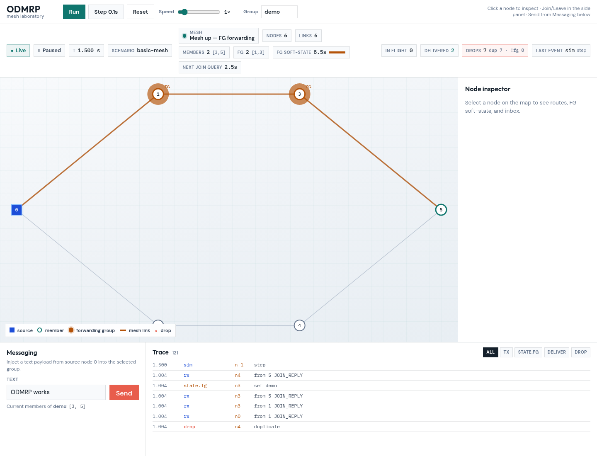
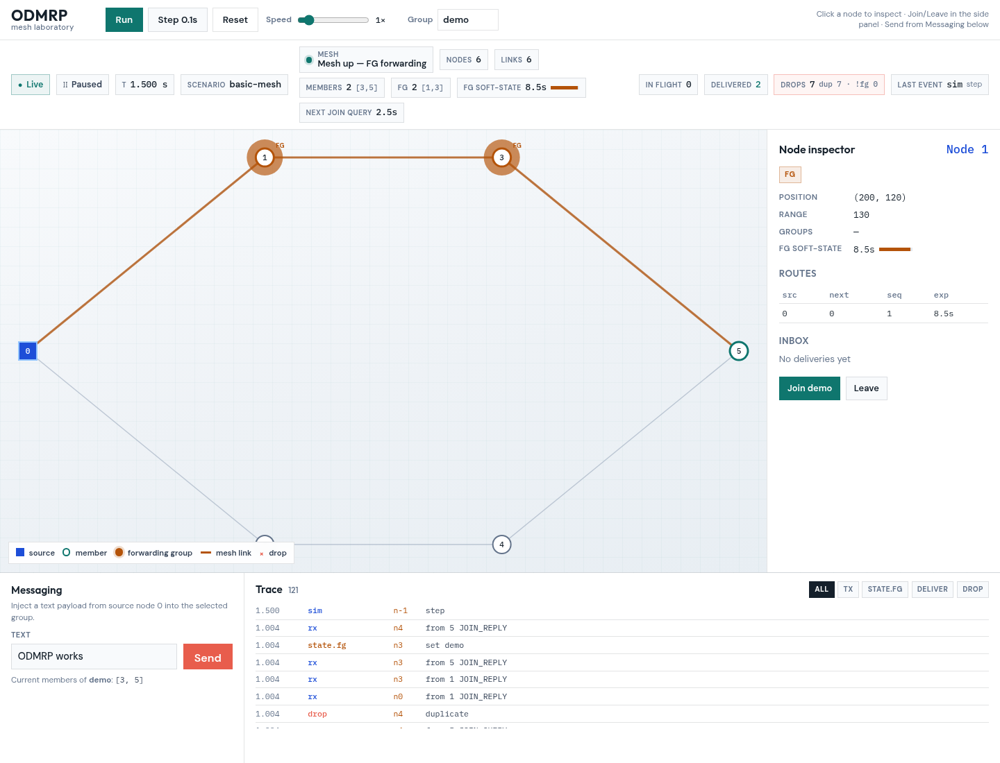
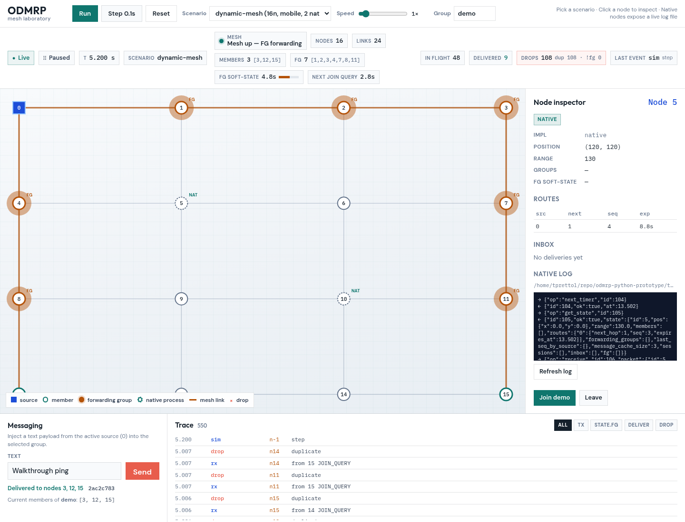
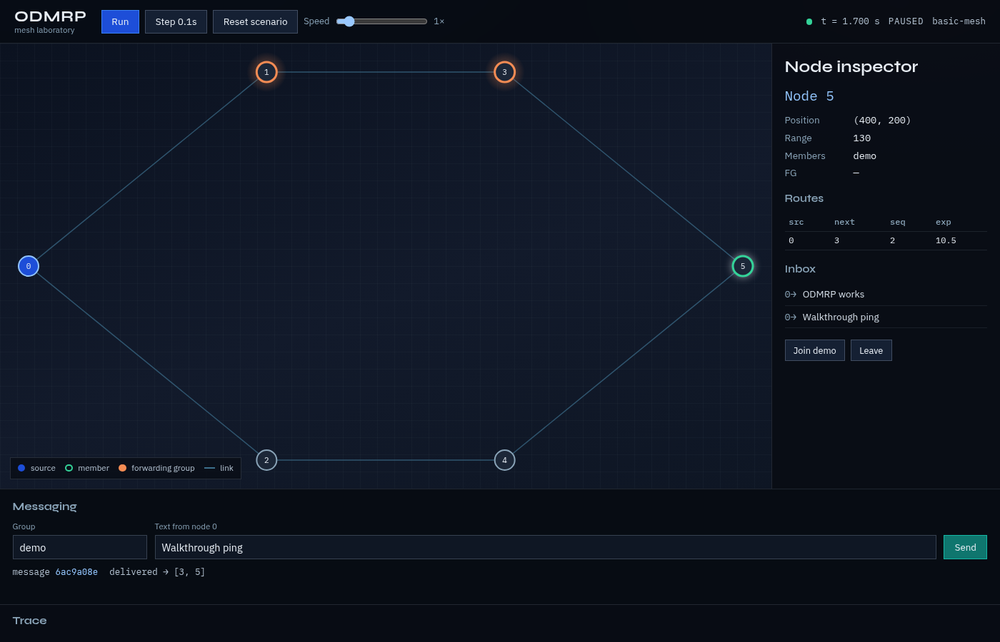
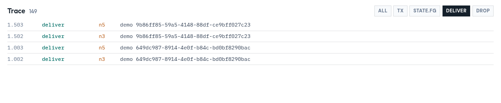
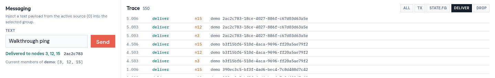

# Demo walkthrough

## Prerequisites
- Python 3.11+
- Node.js 20+

## Install

```bash
cd backend
python3 -m pip install -e '.[dev]'

cd ../frontend
npm install
```

## Run (two terminals)

```bash
# terminal 1 — API + simulator
cd backend
PYTHONPATH=. python3 -m uvicorn odmrp_sim.api.app:app --host 127.0.0.1 --port 8000

# terminal 2 — UI (proxies /api and /ws to :8000)
cd frontend
npm run dev -- --host 127.0.0.1 --port 5173
```

Open http://127.0.0.1:5173/

The UI loads `scenarios/dynamic-mesh.yaml` on connect (16-node grid, waypoint mobility, native process nodes **5** and **10**). Switch to `basic-mesh` from the Scenario dropdown for the classic 6-node ring.

On **dynamic-mesh** after settle you should see:

- A 4×4 grid with denser mesh links and FG/member roles on the path to receivers **3 / 12 / 15**
- **NAT** badges on process-backed nodes **5** and **10** — select one to tail `traces/native-*.log`
- Trace events for `tx` / `rx` / `state.fg` / `deliver` / `topology` as mobility and scripted moves run
- Press **Run** to watch waypoint movers change adjacency live

On **basic-mesh**: source **0**, receivers **3** and **5**, FG on **1** and **3**, inbox text `ODMRP works`.

## Headless scenario

```bash
cd backend
PYTHONPATH=. python3 -m odmrp_sim.cli basic-mesh --trace ../traces/basic-mesh.jsonl
```

## What to try in the UI
1. On **dynamic-mesh**, click a **NAT** node — inspector shows `impl: native` and a live log tail of NDJSON IPC.
2. Click **Run** — waypoint mobility moves nodes **4 / 7 / 12 / 14** and mesh links rewire.
3. Switch Scenario to **basic-mesh** for the small ring; click node **1** for routes / FG.
4. Send another text from Messaging; delivery report lists receivers from the trace.
5. **Reset** reloads the currently selected scenario from a clean seed.

## Screenshots

Network view after `basic-mesh` load (FG halos, status strip, Trace):



Node inspector on forwarding-group node **1**:



After sending a text message:



Receiver **5** inbox:



Trace panel filtered to `deliver`:


Trace close-up:



Messaging + Trace strip:



Regenerate captures (API on :8000, Vite on :5173):

```bash
cd frontend && node scripts/capture_ui_screenshots.mjs
```

## Tests

```bash
cd backend
PYTHONPATH=. python3 -m pytest -q
```
