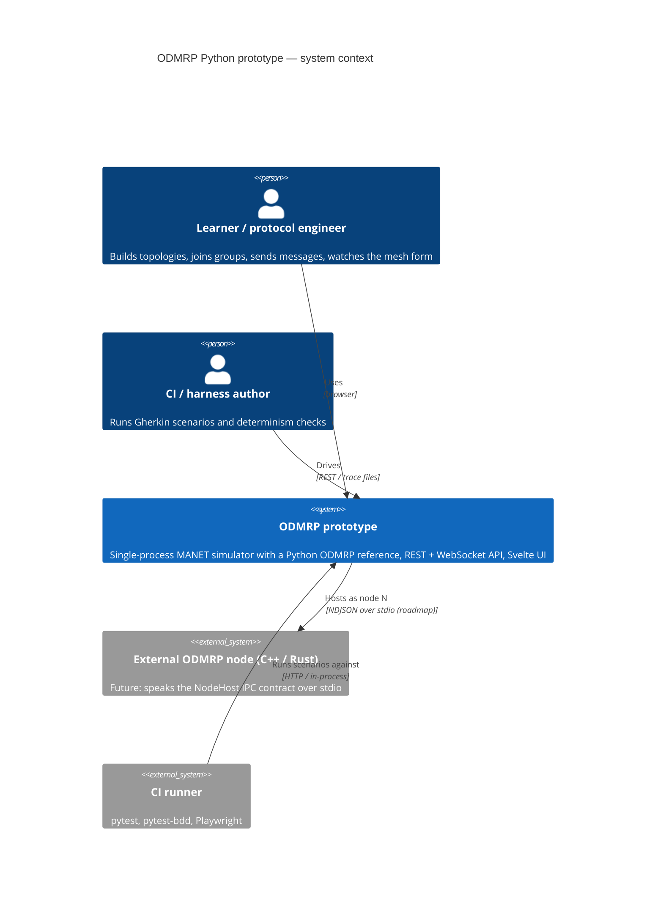
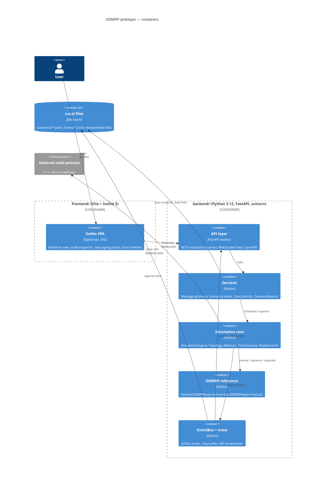
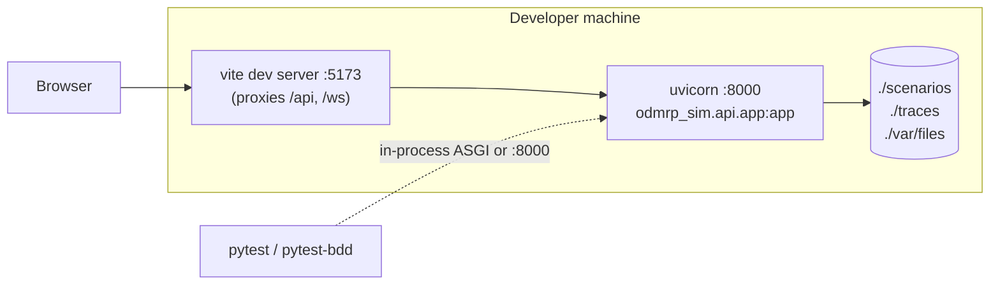

# Architecture 1 — Context and containers

C4 levels 1 and 2 for the prototype. Diagrams are Mermaid; GitHub renders them inline.

## 1.1 System context



## 1.2 Containers



### Container responsibilities

| Container | Owns | Must not |
|---|---|---|
| Svelte SPA | Rendering, local UI state (selection, filters), optimistic drag | Compute protocol state or infer FG membership; everything comes from the server |
| API layer | HTTP/WS framing, validation (pydantic), OpenAPI | Hold simulation state; it only reaches the `SimulationSession` |
| Services | Use-case orchestration: send message, load scenario, step/run | Touch the scheduler directly |
| Simulation core | Time, topology, delivery, timers, node hosting, tracing of every tx/rx | Know ODMRP semantics |
| ODMRP reference | Protocol tables and rules per draft §3.6, §5.1, §5.2 | Read the clock or RNG directly (both arrive via arguments / seeded sub-generator) |
| EventBus + trace | Fan-out of immutable events; durable JSONL | Mutate state |

## 1.3 Deployment (development)



Single process, single simulation session per backend. Multi-session and multi-machine deployment are roadmap items (`odmrp-faw`).

## 1.4 Repository layout (proposed)

```
backend/
  pyproject.toml                 # uv-managed; deps: fastapi, uvicorn, pydantic, pyyaml
  odmrp_sim/
    model/        packets.py  topology.py  params.py  state.py  app_payload.py
    sim/          engine.py   scheduler.py  medium.py  timers.py  node_host.py  rng.py
    protocol/     interface.py  python_node.py  tables.py  seqnum.py  fake_node.py
    events/       bus.py  trace_writer.py  ring_buffer.py  schema.py
    services/     messaging.py  transfers.py  delivery_report.py  scenarios.py  controls.py
    api/          app.py  routers/{network,nodes,groups,messages,files,sim,trace}.py  ws.py  schemas.py
    cli.py                       # run a scenario headless, write trace
  tests/
    unit/        test_topology.py test_scheduler.py test_tables.py test_odmrp_*.py
    api/         test_rest.py test_ws.py
    bdd/         features/*.feature  steps/*.py
  schemas/      trace-event.v1.json  ws-frame.v1.json
frontend/
  src/lib/stores/sim.svelte.ts  src/lib/api.ts
  src/lib/components/{NetworkView,NodeInspector,MessagingPanel,TraceTimeline,Toolbar}.svelte
scenarios/     basic-mesh.yaml  two-sources.yaml  partition.yaml
docs/          (this directory)
```
