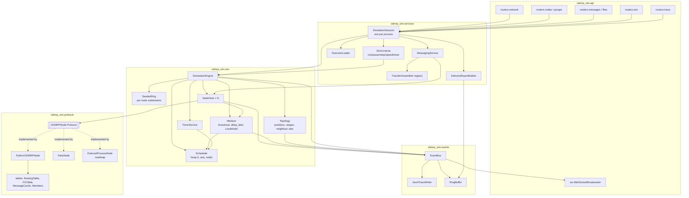
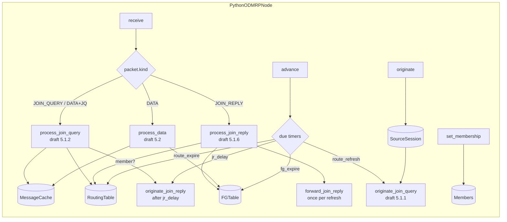
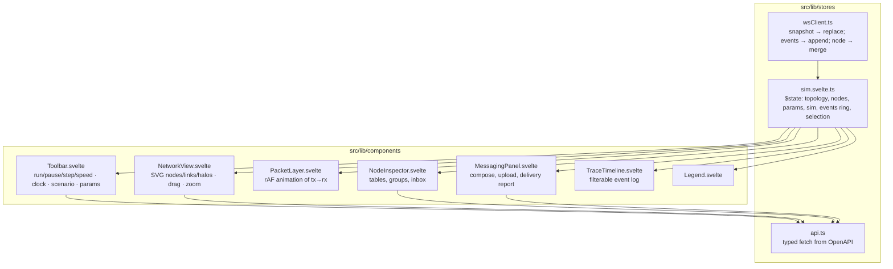

# Architecture 2 — Components and modules

C4 level 3 for the backend and the frontend, plus the one rule that keeps the harness goal intact: **only `NodeHost` talks to an `ODMRPNode`, and only `Medium` delivers packets.**

## 2.1 Backend components

### Component contracts

| Component | Key API | Notes |
|---|---|---|
| `Scheduler` | `schedule(t, node, fn, *args) -> handle`, `cancel(handle)`, `pop() -> Event`, `peek_time()` | Heap keyed `(t, global_seq, node_id)`. `global_seq` is a monotonically increasing counter, so equal-time events run in scheduling order. |
| `SeededRng` | `for_node(node_id) -> random.Random` | Substream seed = `hash((seed, node_id))`; the medium uses `for_node(sender)` for jitter so adding nodes does not perturb others. |
| `Topology` | `add(node_spec)`, `remove(id)`, `move(id, pos, now)`, `neighbors(id) -> frozenset`, `links() -> set[tuple]` | Incremental recompute on move; publishes `topology` events with link deltas only. |
| `Medium` | `broadcast(sender, packet, now)` | For each current neighbour: `t_rx = now + hop_delay + rng.uniform(0, jitter)`; `LossModel.drop(sender, receiver, packet) -> bool` hook (default never). Publishes `tx`, `rx`, `drop`. |
| `TimerService` | `arm(node, key, at, payload)`, `disarm(node, key)` | Re-arming a key cancels the previous handle; the host calls `node.advance(now)` when a timer fires. |
| `NodeHost` | `deliver(packet, prev_hop, now)`, `tick(now)`, `originate(group, payload, now)`, `set_membership(group, bool, now)`, `state()` | Wraps one `ODMRPNode`; every returned packet goes to `Medium.broadcast` and a `tx` event. Also diffs `NodeState` before/after each call to emit `state.*` events, so implementations do not need to emit events themselves. |
| `EventBus` | `publish(event)`, `subscribe(fn)` | Synchronous fan-out; subscribers must not block. |
| `SimulationSession` | `load(scenario)`, `engine`, `messaging`, `controls` | The single object the API holds. |

### Why `NodeHost` diffs state instead of asking nodes to emit events

External implementations only have to implement the seven `ODMRPNode` methods; they never see the event schema. The host snapshots `get_state()` after every call and publishes `state.route`, `state.fg`, `state.member` deltas. It is slightly more work per call (state is small: a few dicts) and removes an entire class of conformance bugs.

## 2.2 Python reference node internals

Every handler returns `list[Packet]`; no handler schedules or transmits. Timers are expressed by `next_timer()` plus internal due-lists, so the same code can run against the simulator or a real clock later.

## 2.3 Frontend components

Rules: components never fetch directly except through `api.ts`; `NetworkView` positions come only from the store (drag applies an optimistic position, then `PUT /api/nodes/{id}/position`; the next snapshot/node delta is authoritative).

## 2.4 Cross-cutting

- **Identifiers** (ADR-001): `NodeId = int`, `GroupId = str`, `PacketId = str` (`f"{src}:{seq}"` for protocol packets; UUID for app payloads).
- **Time**: `float` seconds of simulation time everywhere in the backend; the WS frame carries `sim.t` and the UI formats it. No `time.time()` inside `sim/` or `protocol/` (enforced by a test that greps the package).
- **Errors**: protocol handlers never raise on malformed packets; they return `[]` and the host emits `drop reason=malformed`.
- **Configuration**: `ProtocolParams` is immutable per network; changing it via REST resets the session with the same topology and seed.
