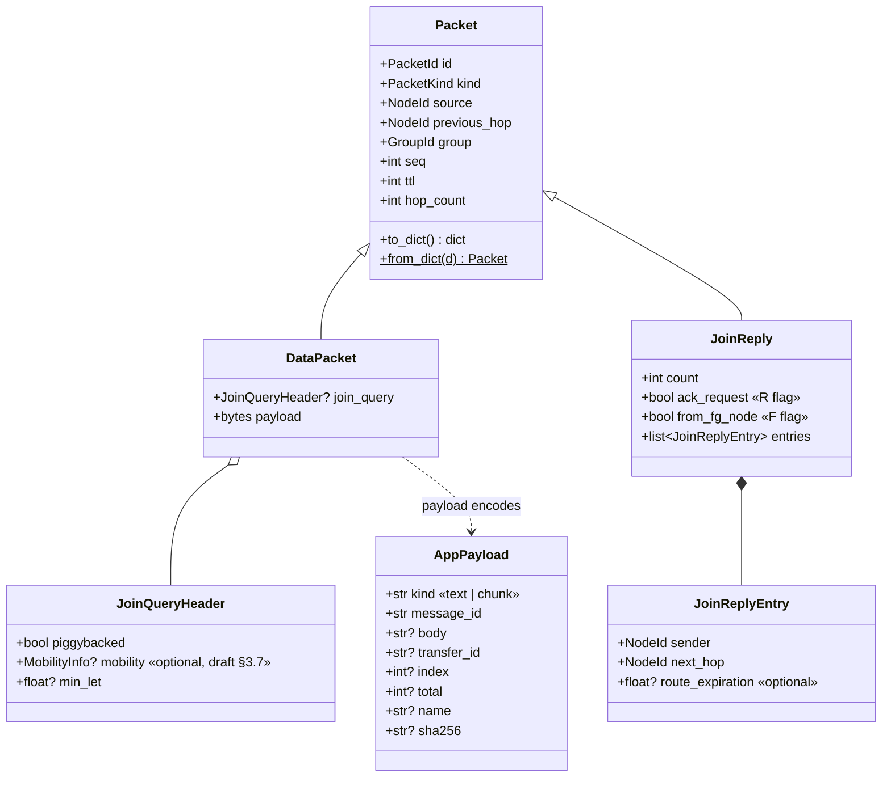
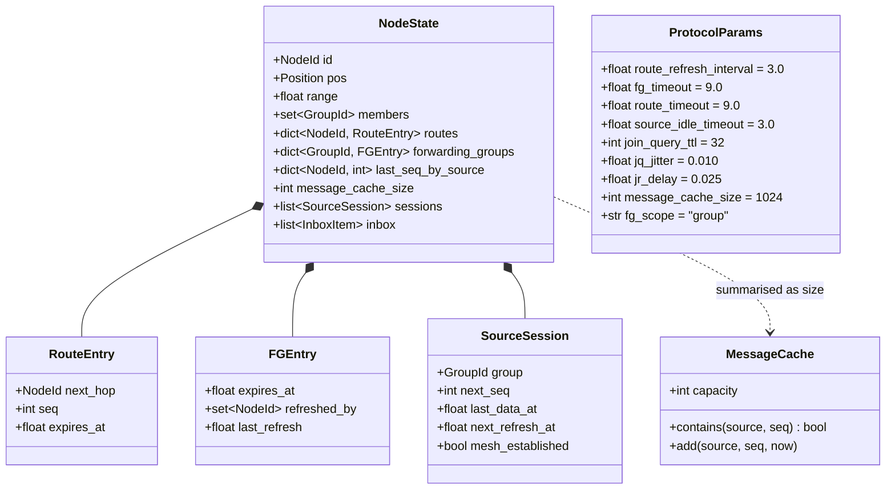

# Architecture 3 — Data model and interfaces

Normative for Phase 1–4 beads. Field names mirror draft-ietf-manet-odmrp-04 §4 so a wire codec (fixed header or RFC 5444) is a pure mapping.

## 3.1 Packet model



`PacketKind ∈ {JOIN_QUERY, JOIN_REPLY, DATA}`. A `DataPacket` whose `join_query` is set is traced as `JOIN_QUERY` with `piggybacked=true` and an empty-payload `DataPacket` with a header is the standalone Join Query (ADR-002). For a `JoinReply`, `seq` is "assigned by the previous hop node to uniquely identify the packet" (draft §4.2), i.e. the transmitting node's own counter, not the source's.

## 3.2 Node state and tables



Mapping to the draft's tables: `routes` = Routing Table (§3.6.1), `forwarding_groups` = Forwarding Group Table (§3.6.2, keyed by group per ADR-003), `MessageCache` = Message Cache (§3.6.3). `SourceSession` and `inbox` are prototype additions for observability.

## 3.3 ODMRPNode interface (ADR-005)

```python
class ODMRPNode(Protocol):
    def configure(self, node_id: NodeId, params: ProtocolParams, rng_seed: int) -> None: ...
    def set_membership(self, group: GroupId, member: bool, now: float) -> list[Packet]: ...
    def originate(self, group: GroupId, payload: bytes, now: float) -> list[Packet]: ...
    def receive(self, packet: Packet, previous_hop: NodeId, now: float) -> list[Packet]: ...
    def advance(self, now: float) -> list[Packet]: ...
    def next_timer(self) -> float | None: ...
    def get_state(self) -> NodeState: ...
```

Contract:

- Methods are called sequentially by `NodeHost`; implementations need no locking.
- `now` is monotonic non-decreasing across calls to one node.
- Returned packets are transmitted immediately (broadcast) in list order; the host fills `previous_hop` if the node left it unset.
- `advance(now)` must fire every timer with `due <= now`, in due order, and may return packets from several timers.
- `next_timer()` is advisory; the host also calls `advance` after every other call.
- `get_state()` returns a snapshot (the host may keep a reference; implementations return a fresh object).

The same seven operations form the external-node IPC (see `../sequences/06-external-node-adapter.md`).

## 3.4 Trace events (ADR-006)

Every event is one JSON object per line. Common envelope:

| Field | Type | Meaning |
|---|---|---|
| `t` | number | Simulation time (s) |
| `seq` | integer | Global monotonic counter; `(t, seq)` is the total order |
| `node` | integer | Node the event is about (`-1` for `sim`/`topology`) |
| `kind` | string | One of the kinds below |

| `kind` | Payload fields | Emitted by |
|---|---|---|
| `tx` | `packet` (full `to_dict()`), `neighbors: [id]` | `Medium` |
| `rx` | `packet_id`, `from`, `pkind` | `Medium` |
| `drop` | `packet_id`, `reason ∈ {duplicate, not_fg, ttl, loss, malformed}` | `NodeHost` / `Medium` |
| `state.route` | `source`, `next_hop`, `seq`, `expires_at`, `op ∈ {set, refresh, expire}` | `NodeHost` (state diff) |
| `state.fg` | `group`, `expires_at`, `refreshed_by`, `op ∈ {set, refresh, expire}` | `NodeHost` |
| `state.member` | `group`, `member: bool` | `NodeHost` |
| `timer` | `key`, `op ∈ {arm, fire, cancel}`, `at` | `TimerService` |
| `deliver` | `packet_id`, `message_id`, `group`, `app_kind`, `index?`, `total?` | `NodeHost` |
| `transfer` | `transfer_id`, `op ∈ {start, chunk, complete, verify_failed}`, `received`, `total` | `TransferAssembler` |
| `topology` | `op ∈ {add, remove, move, link_up, link_down}`, `a`, `b?`, `pos?` | `Topology` |
| `sim` | `op ∈ {load, run, pause, step, reset, params}`, `seed?`, `scenario?` | `SimulationEngine` |

Determinism diffing compares the sequence of `(kind, node, payload)` after stripping `seq`; the `(t, seq)` order is already canonical.

## 3.5 REST API

Base path `/api`. All bodies JSON unless noted. Errors use RFC 9457 problem details.

| Method | Path | Purpose | Bead |
|---|---|---|---|
| GET | `/health` | Version, sim time, mode | `odmrp-deb` |
| POST | `/network` | Create network from inline spec `{nodes:[{id,x,y,range?}], range, params?, seed?}` | `odmrp-u70` |
| POST | `/network/scenario` | Load `scenarios/<name>.yaml` | `odmrp-3d6` |
| GET | `/network` | Topology + links + params + sim status | `odmrp-u70` |
| POST | `/nodes` | Add node `{x,y,range?}` → `{id}` | `odmrp-3d6` |
| DELETE | `/nodes/{id}` | Remove node | `odmrp-3d6` |
| PUT | `/nodes/{id}/position` | Move node `{x,y}` | `odmrp-3d6` |
| GET | `/nodes/{id}` | `NodeState` | `odmrp-3d6` |
| POST | `/nodes/{id}/groups` | Join `{group}` | `odmrp-3d6` |
| DELETE | `/nodes/{id}/groups/{group}` | Leave | `odmrp-3d6` |
| POST | `/messages` | `{source, group, text}` → `{message_id}` | `odmrp-3d6` |
| POST | `/files` | multipart `source, group, file` → `{transfer_id, total}` | `odmrp-3d6` |
| GET | `/files/{transfer_id}/receivers/{node}` | Download reassembled file (404 while incomplete, with `missing`) | `odmrp-3d6` |
| GET | `/messages/{message_id}/report` | `DeliveryReport` | `odmrp-3d6` |
| GET | `/params` / PUT `/params` | Read / replace `ProtocolParams` (PUT resets session) | `odmrp-3d6` |
| POST | `/sim/run` `/sim/pause` `/sim/reset` | Mode changes | `odmrp-f2f` |
| POST | `/sim/step` | `{dt}` (paused only; 409 otherwise) | `odmrp-f2f` |
| PUT | `/sim/speed` | `{multiplier}` | `odmrp-f2f` |
| GET | `/trace?after_seq=&kinds=&node=&limit=` | Ring-buffer query | `odmrp-3d6` |
| GET | `/trace/download` | Full JSONL for the session | `odmrp-3d6` |

## 3.6 WebSocket `/ws`

Server → client frames:

```jsonc
{ "type": "snapshot", "sim": {"t": 0, "mode": "paused", "speed": 1, "seed": 42, "scenario": "basic-mesh"},
  "params": { ... ProtocolParams ... }, "topology": {"nodes": [...], "links": [[0,1], ...]},
  "nodes": { "0": { ...NodeState... }, ... }, "last_seq": 1234 }
{ "type": "events", "events": [ { ...trace event... }, ... ] }       // coalesced ≤ every 50 ms
{ "type": "node", "id": 3, "state": { ...NodeState... } }           // after any state.* for node 3
{ "type": "sim", "sim": { "t": 12.5, "mode": "running", "speed": 2 } }
```

Client → server: none (all mutations via REST). On reconnect the client sends `?after_seq=` and receives a fresh snapshot plus a replay of ring-buffered events after that sequence number, if still available.

Backpressure: if a client's send queue exceeds 200 frames, `tx`/`rx`/`timer` events are dropped for that client and a `{"type":"gap","from_seq":..,"to_seq":..}` frame is inserted; `state.*`, `deliver`, `topology`, `sim` are never dropped.

## 3.7 Scenario file

```yaml
# scenarios/basic-mesh.yaml
name: basic-mesh
seed: 42
range: 130
params: { route_refresh_interval: 3.0, fg_timeout: 9.0, jq_jitter: 0.0, jr_delay: 0.0 }
nodes:
  - { id: 0, x: 100, y: 200 }   # source
  - { id: 1, x: 200, y: 120 }
  - { id: 2, x: 200, y: 280 }
  - { id: 3, x: 300, y: 120 }   # receiver
  - { id: 4, x: 300, y: 280 }
  - { id: 5, x: 400, y: 200 }   # receiver
script:
  - { at: 0.0, op: join,  node: 3, group: demo }
  - { at: 0.0, op: join,  node: 5, group: demo }
  - { at: 1.0, op: text,  node: 0, group: demo, text: "ODMRP works" }
expect:
  fg_nodes: [1, 3]                # with jitter 0; see sequences/01 for the jittered alternative {1, 2, 4}
  delivered_to: [3, 5]
```

Links with range 130 (distances: 0–1 and 0–2 = 128.1, 1–3 and 2–4 = 100, 3–5 and 4–5 = 128.1; 1–2 and 3–4 = 160, unlinked): a ring `0–1–3–5–4–2–0` giving two node-disjoint paths from the source to receiver 5, which is what makes the forwarding-group selection visible. The walk-through is in `../sequences/01-mesh-formation.md`.
