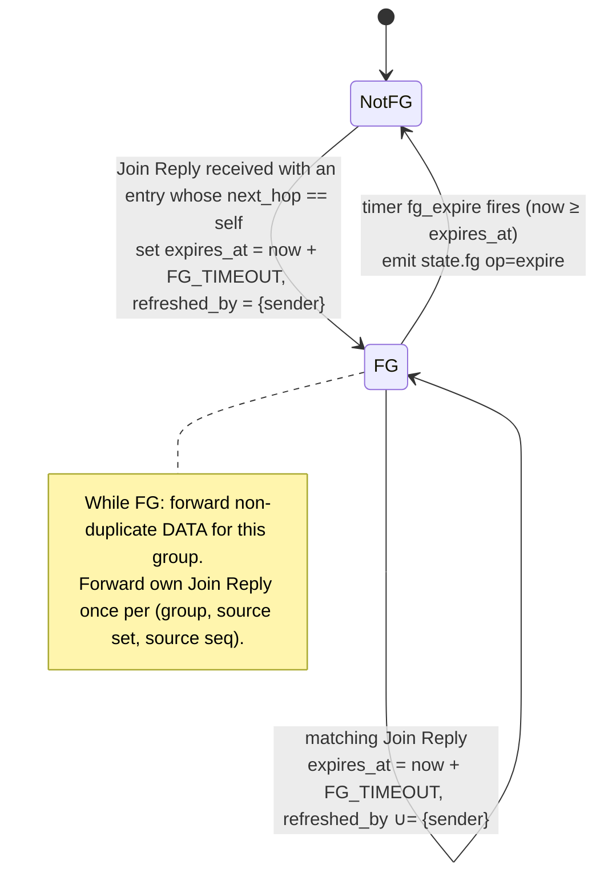
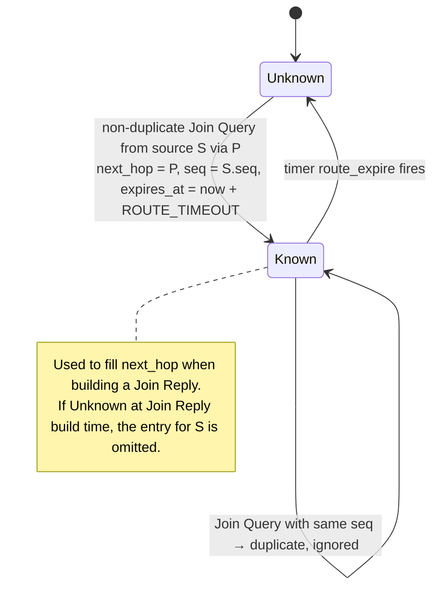
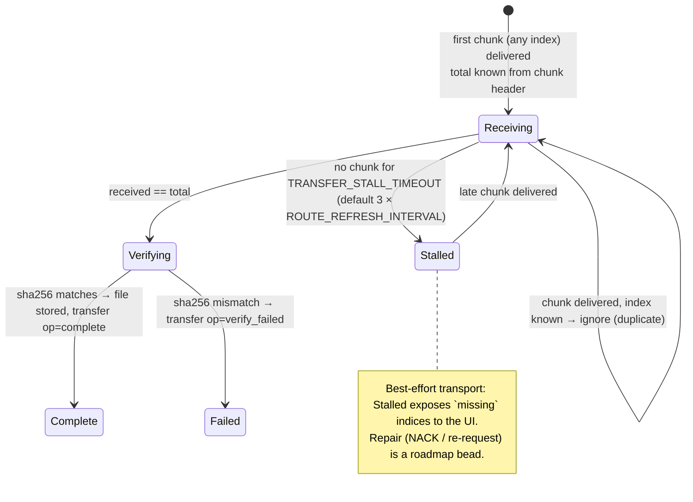
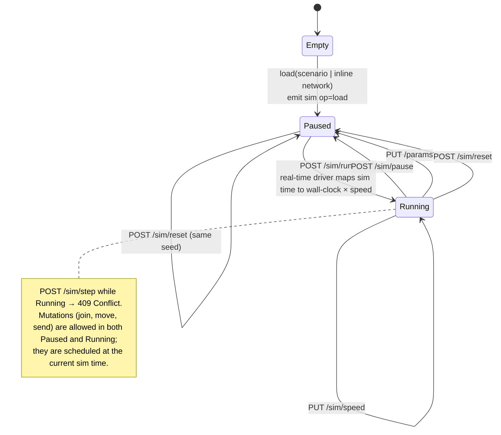
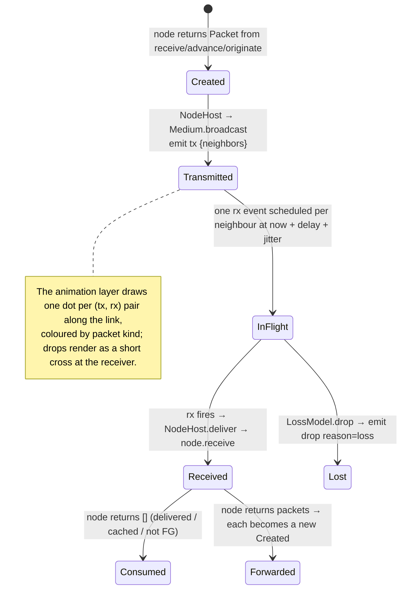

# Architecture 4 — State machines

Per-entity state machines that the Phase 1–3 beads implement. All transitions are driven by simulation time or packets; none by wall-clock.

## 4.1 Forwarding-group entry (per node, per group) — draft §3.6.2, §5.1.6, §3.3



## 4.2 Routing entry (per node, per source) — draft §3.6.1, §5.1.2



## 4.3 Source session (per source node, per group) — draft §5.1.1, §3.3

```mermaid
stateDiagram-v2
  [*] --> Idle
  Idle --> Querying : originate(group, payload)<br/>seq += 1; send DATA with Join Query header (piggybacked);<br/>arm route_refresh = now + ROUTE_REFRESH_INTERVAL
  Querying --> Established : Join Reply received with entry (sender == self)
  Established --> Established : originate() → send DATA (no header)
  Querying --> Querying : originate() → send DATA (no header)
  Established --> Refreshing : route_refresh fires
  Querying --> Refreshing : route_refresh fires
  Refreshing --> Querying : data queued or sent within SOURCE_IDLE_TIMEOUT<br/>seq += 1; send Join Query (piggybacked if data queued, else standalone);<br/>re-arm route_refresh
  Refreshing --> Idle : no data for SOURCE_IDLE_TIMEOUT<br/>stop refreshing (soft leave)
  note right of Established
    "Established" is observational only (UI badge);
    forwarding never depends on it.
  end note
```

## 4.4 Group membership (per node, per group) — receiver side

```mermaid
stateDiagram-v2
  [*] --> NonMember
  NonMember --> MemberPending : set_membership(group, true)<br/>emit state.member
  MemberPending --> MemberActive : Join Query for group received<br/>→ Join Reply originated after JR_DELAY
  MemberActive --> MemberActive : each new Join Query → new Join Reply
  MemberActive --> NonMember : set_membership(group, false)<br/>(no leave packet; FG nodes expire upstream)
  MemberPending --> NonMember : set_membership(group, false)
  note right of MemberPending
    Visible in the UI as "pending": the node will not receive data
    until the source's next refresh (≤ ROUTE_REFRESH_INTERVAL).
  end note
```



## 4.5 Transfer assembler (per receiver, per transfer_id) — Phase 3



## 4.6 Simulation engine run modes — Phase 1 / Phase 4



## 4.7 Packet life cycle (for the trace and the animation layer)


