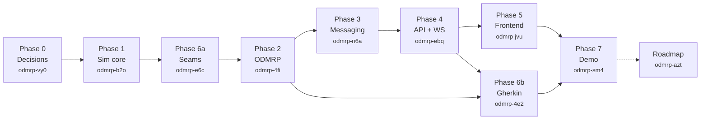

# Implementation plan (beads)

This plan is tracked with [beads](https://github.com/steveyegge/beads) (`bd`). The issue graph lives in the
Dolt database under `.beads/` (not committed) and is exported to `.beads/issues.jsonl` (committed).
The human-authored source of the graph is `docs/beads/graph-plan.json`.

```bash
# fresh clone: load the graph into a local beads database
bd init --prefix odmrp --non-interactive --init-if-missing
bd import -i .beads/issues.jsonl

bd ready                 # what can be started now (no open blockers)
bd show odmrp-4fi        # an epic, with children and dependencies
bd graph odmrp-4fi       # dependency tree of an epic
bd update odmrp-58d --status in_progress   # claim a task
bd close odmrp-58d       # finish it; unblocks dependents
bd export -o .beads/issues.jsonl           # refresh the committed snapshot
```

## Sequencing rationale

The order below differs from `tasks.md` in two deliberate ways, both argued in
`docs/review/architecture-review.md`:

1. **Phase 0 (decisions) is new.** Seven ADR-style `decision` beads settle the packet model, table scope,
   node interface and trace schema before any code depends on them.
2. **Phase 6a is pulled forward.** The `ODMRPNode` seam and the JSON-lines trace are built right after the
   simulation core so the Python reference is written against the seam and every protocol test asserts on
   trace events rather than internal state.

Everything else keeps the `tasks.md` phase numbering so the two documents stay cross-referenceable.

## Phase overview



## Beads by epic

Run `bd list` for live status. "Blocked by" lists the beads that must close first (`blocks` edges); parent-child edges are implied by the table grouping.

### Phase 0 - Architecture decisions and spec reconciliation — `odmrp-vy0`

Resolve the open design questions raised in docs/review/architecture-review.md before code is written. Each child is a `decision` bead (ADR-style): record the chosen option in the bead, then patch design.md / specs so the Gherkin and the code agree.

| Bead | Type | P | Title | Blocked by |
|---|---|---|---|---|
| `odmrp-e47` | decision | P1 | ADR-001: Canonical identifiers (NodeId, GroupId, sequence number space) | — |
| `odmrp-4i9` | decision | P1 | ADR-002: Join Query as piggybacked data-packet header vs. standalone control packet | — |
| `odmrp-1wq` | decision | P1 | ADR-003: Forwarding Group table scope - per group (draft) vs per (source, group) (repo spec) | — |
| `odmrp-3fq` | decision | P1 | ADR-004: Join Reply as a table of (Sender, NextHop) entries with Count/R/F flags | — |
| `odmrp-e7x` | decision | P1 | ADR-005: ODMRPNode interface (time-driven, pure outputs) for Python and external nodes | — |
| `odmrp-0e3` | decision | P1 | ADR-006: Trace / event schema v1 (JSON lines) shared by WebSocket, tests and external validation | — |
| `odmrp-4z9` | decision | P2 | ADR-007: Frontend rendering approach (plain SVG in Svelte vs vis-network) | — |

### Phase 1 - Simulation core (topology, clock, delivery) — `odmrp-b2o`

Single-process discrete-event MANET simulator: nodes with 2D positions and radio range, distance-based neighbours, a deterministic scheduler, broadcast delivery to current neighbours, per-node timers. No protocol logic yet. Spec: specs/simulation/spec.md.

| Bead | Type | P | Title | Blocked by |
|---|---|---|---|---|
| `odmrp-58d` | task | P1 | Define Packet, Node, Topology and protocol header dataclasses | `odmrp-e47` |
| `odmrp-ehv` | task | P1 | Distance-based neighbour computation (unit-disk, symmetric) | `odmrp-58d` |
| `odmrp-d3t` | task | P1 | Discrete-event scheduler with deterministic ordering and seeded RNG | `odmrp-58d` |
| `odmrp-5fz` | task | P1 | Broadcast packet delivery to current neighbours with per-hop delay and jitter | `odmrp-ehv`, `odmrp-d3t` |
| `odmrp-tzv` | task | P1 | Per-node timer service driven by the simulation clock | `odmrp-d3t` |
| `odmrp-u70` | task | P2 | Minimal REST: create network, get state, step time | `odmrp-5fz` |

### Phase 6a - Test-harness seams (node interface + trace), pulled forward — `odmrp-e6c`

tasks.md puts the ODMRPNode protocol and the JSON-lines trace in Phase 6. The review recommends landing both *before* the protocol implementation so the Python reference is written against the seam from day one and every Phase 2 unit test can assert on trace events. Spec: specs/test-harness/spec.md.

| Bead | Type | P | Title | Blocked by |
|---|---|---|---|---|
| `odmrp-42n` | task | P1 | Implement the ODMRPNode Protocol, NodeHost wrapper and FakeNode | `odmrp-e7x`, `odmrp-58d`, `odmrp-tzv` |
| `odmrp-zdb` | task | P1 | Event bus and JSON-lines trace writer (schema v1) | `odmrp-0e3`, `odmrp-d3t` |

### Phase 2 - ODMRP reference implementation (Python) — `odmrp-4fi`

Per-node ODMRP state machine per draft-ietf-manet-odmrp-04 sections 3.6, 5.1, 5.2 behind the ODMRPNode seam. Spec: specs/odmrp/spec.md. Reference behaviour cross-checked against docs/review/adherence-matrix.md.

| Bead | Type | P | Title | Blocked by |
|---|---|---|---|---|
| `odmrp-b21` | task | P1 | Node tables: routing table, forwarding-group table, message cache, member set | `odmrp-1wq`, `odmrp-3fq`, `odmrp-42n` |
| `odmrp-iql` | task | P1 | Sequence number management with wrap-around comparison | `odmrp-e47` |
| `odmrp-g0v` | task | P1 | Source: originate Join Query on demand and refresh every ROUTE_REFRESH_INTERVAL while data is pending | `odmrp-4i9`, `odmrp-b21`, `odmrp-iql`, `odmrp-5fz` |
| `odmrp-0ew` | task | P1 | Process Join Query: duplicate check, backward learning, member reply, hop/TTL, rebroadcast | `odmrp-g0v` |
| `odmrp-zig` | task | P1 | Receiver: originate Join Reply table toward all known sources of the group | `odmrp-0ew` |
| `odmrp-vlo` | task | P1 | Process Join Reply: match next-hop, set FG_FLAG, build and forward own Join Reply once per refresh | `odmrp-zig` |
| `odmrp-co6` | task | P1 | Soft-state expiry: FG_TIMEOUT, ROUTE_TIMEOUT, member-less leave | `odmrp-vlo` |
| `odmrp-2xj` | task | P1 | Data forwarding: forward iff FG member and non-duplicate; local delivery to group members | `odmrp-vlo` |
| `odmrp-amm` | task | P2 | ProtocolParams: configurable timers, TTL, jitter, cache size, fg_scope | `odmrp-b21` |
| `odmrp-rlo` | task | P1 | pytest suite mapping every specs/odmrp/spec.md scenario to a stepped-clock test | `odmrp-2xj`, `odmrp-co6`, `odmrp-amm`, `odmrp-zdb` |

### Phase 3 - Messaging and file transfer — `odmrp-n6a`

Application layer on top of ODMRP data packets: text messages, chunked file transfers with reassembly, delivery reports. Spec: specs/messaging/spec.md. Best-effort only (no retransmission) - matches the lossless simulator; repair is a roadmap bead.

| Bead | Type | P | Title | Blocked by |
|---|---|---|---|---|
| `odmrp-2kc` | task | P2 | MessagingService: inject a text message at a source for a group | `odmrp-2xj` |
| `odmrp-a1c` | task | P2 | File chunking (transfer_id, index, total, sha256) and receiver reassembly | `odmrp-2kc` |
| `odmrp-o8u` | task | P2 | Delivery report: receivers reached and path(s) taken, derived from the trace | `odmrp-a1c`, `odmrp-zdb` |

### Phase 4 - FastAPI REST + WebSocket — `odmrp-ebq`

HTTP control plane and real-time push. REST mutates/queries; WebSocket streams a snapshot on connect then deltas (topology, node state, trace events) using the ADR-006 schema. Pause/resume/step/speed controls.

| Bead | Type | P | Title | Blocked by |
|---|---|---|---|---|
| `odmrp-deb` | task | P2 | FastAPI application skeleton: settings, lifespan, single Simulation session, CORS | `odmrp-u70` |
| `odmrp-3d6` | task | P2 | REST endpoints: network, nodes, groups, messages, files, scenarios, params | `odmrp-deb`, `odmrp-a1c`, `odmrp-amm` |
| `odmrp-hlj` | task | P2 | WebSocket /ws: snapshot on connect, then batched deltas and trace events | `odmrp-deb`, `odmrp-zdb` |
| `odmrp-f2f` | task | P2 | Simulation controls: run / pause / step(dt) / speed / reset | `odmrp-hlj` |
| `odmrp-o4x` | task | P2 | API tests with httpx + websockets covering the happy-path demo | `odmrp-3d6`, `odmrp-f2f`, `odmrp-o8u` |

### Phase 5 - Svelte frontend — `odmrp-jvu`

Interactive visualisation per specs/visualization/spec.md and the wireframes in docs/mockups/. Svelte 5 + TypeScript + Vite; plain SVG rendering (ADR-007).

| Bead | Type | P | Title | Blocked by |
|---|---|---|---|---|
| `odmrp-2q8` | task | P2 | Frontend scaffold: Vite + Svelte 5 + TS, typed WS store, REST client | `odmrp-4z9`, `odmrp-hlj` |
| `odmrp-ey7` | task | P2 | NetworkView: render nodes at simulated positions and links between neighbours | `odmrp-2q8` |
| `odmrp-g22` | task | P2 | Highlight source, group members and forwarding-group nodes for the selected session | `odmrp-ey7` |
| `odmrp-huq` | task | P2 | Packet animation and event log | `odmrp-g22` |
| `odmrp-ak4` | task | P2 | Toolbar, node inspector and group controls | `odmrp-ey7`, `odmrp-3d6`, `odmrp-f2f` |
| `odmrp-5y1` | task | P2 | Messaging panel: send text, upload file, delivery report with paths | `odmrp-ak4`, `odmrp-o8u` |

### Phase 6b - Executable Gherkin and determinism harness — `odmrp-4e2`

Turn the spec scenarios into executable acceptance tests against the running API, and lock in deterministic replay. Spec: specs/test-harness/spec.md.

| Bead | Type | P | Title | Blocked by |
|---|---|---|---|---|
| `odmrp-ea3` | task | P2 | pytest-bdd step library and feature files extracted from specs/*/spec.md | `odmrp-o4x` |
| `odmrp-7vc` | task | P2 | Deterministic replay test: identical traces and FG sets across runs | `odmrp-rlo` |
| `odmrp-hbl` | task | P2 | Document the external node contract (IPC messages, lifecycle, conformance checklist) | `odmrp-42n`, `odmrp-hlj` |

### Phase 7 - Demo closure — `odmrp-sm4`

Make the happy-path demo reproducible: exact commands, scenario fixture, screenshots, and the roadmap kept in beads.

| Bead | Type | P | Title | Blocked by |
|---|---|---|---|---|
| `odmrp-h83` | task | P3 | DEMO.md commands, scenarios/basic-mesh.yaml fixture, screenshots | `odmrp-5y1`, `odmrp-huq`, `odmrp-ea3`, `odmrp-7vc` |

### Roadmap - production / multi-language validation (from beads.md) — `odmrp-azt`

Items intentionally outside the prototype. Imported from beads.md so they carry dependencies on the prototype work that enables them. Not scheduled.

| Bead | Type | P | Title | Blocked by |
|---|---|---|---|---|
| `odmrp-bv6` | feature | P3 | Join Reply reliability: passive acknowledgement, R flag, retransmission, route invalidation | `odmrp-co6` |
| `odmrp-dn0` | feature | P3 | External node adapter (process-based, NDJSON or protobuf IPC) for C++/Rust nodes | `odmrp-hbl` |
| `odmrp-izv` | feature | P3 | Deterministic multi-implementation comparison (trace diff in CI) | `odmrp-dn0`, `odmrp-dml` |
| `odmrp-32m` | feature | P4 | Real networking mode (UDP sockets / TUN-TAP overlay) incl. RFC 5444 codec | `odmrp-dn0`, `odmrp-bv6` |
| `odmrp-m84` | feature | P4 | Mobility models (random waypoint, Gauss-Markov, scripted) with movement visualisation | `odmrp-huq` |
| `odmrp-9bc` | feature | P4 | Packet loss and collision model (probabilistic loss, hidden terminal, 802.11-like MAC) | `odmrp-bv6` |
| `odmrp-ujn` | feature | P4 | Unidirectional link detection and blacklist (ODMRP-ASYM style) | `odmrp-bv6`, `odmrp-9bc` |
| `odmrp-dml` | feature | P4 | Persistent scenario library with expected traces (regression fixtures) | `odmrp-7vc` |
| `odmrp-5z4` | feature | P4 | Observability: OpenTelemetry traces, Prometheus metrics (control overhead, delivery ratio, FG size) | `odmrp-zdb` |
| `odmrp-0q4` | feature | P4 | Optional packet authentication and integrity | `odmrp-32m` |
| `odmrp-faw` | feature | P4 | Distributed deployment across machines/containers | `odmrp-32m` |
| `odmrp-c78` | feature | P4 | Mobility prediction / adaptive refresh (GPS fields, RET, E-ODMRP style) | `odmrp-co6` |

## Full dependency graph

Arrows point from a bead to the bead that blocks it (same direction as `bd dep`). Epics omitted for legibility.

```mermaid
flowchart TB
  subgraph e0["Phase 0"]
    d_ids["odmrp-e47<br/>ADR-001: Canonical identifiers (NodeId, GroupI…"]:::dec
    d_jq_piggyback["odmrp-4i9<br/>ADR-002: Join Query as piggybacked data-packet…"]:::dec
    d_fg_scope["odmrp-1wq<br/>ADR-003: Forwarding Group table scope - per gr…"]:::dec
    d_jr_table["odmrp-3fq<br/>ADR-004: Join Reply as a table of (Sender, Nex…"]:::dec
    d_interface["odmrp-e7x<br/>ADR-005: ODMRPNode interface (time-driven, pur…"]:::dec
    d_trace["odmrp-0e3<br/>ADR-006: Trace / event schema v1 (JSON lines) …"]:::dec
    d_frontend["odmrp-4z9<br/>ADR-007: Frontend rendering approach (plain SV…"]:::dec
  end
  subgraph e1["Phase 1"]
    p1_models["odmrp-58d<br/>Define Packet, Node, Topology and protocol hea…"]:::p1
    p1_neighbors["odmrp-ehv<br/>Distance-based neighbour computation (unit-dis…"]:::p1
    p1_clock["odmrp-d3t<br/>Discrete-event scheduler with deterministic or…"]:::p1
    p1_delivery["odmrp-5fz<br/>Broadcast packet delivery to current neighbour…"]:::p1
    p1_timers["odmrp-tzv<br/>Per-node timer service driven by the simulatio…"]:::p1
    p1_rest_min["odmrp-u70<br/>Minimal REST: create network, get state, step …"]:::p1
  end
  subgraph e6a["Phase 6a"]
    p6_protocol["odmrp-42n<br/>Implement the ODMRPNode Protocol, NodeHost wra…"]:::p6
    p6_trace["odmrp-zdb<br/>Event bus and JSON-lines trace writer (schema …"]:::p6
  end
  subgraph e2["Phase 2"]
    p2_tables["odmrp-b21<br/>Node tables: routing table, forwarding-group t…"]:::p2
    p2_seq["odmrp-iql<br/>Sequence number management with wrap-around co…"]:::p2
    p2_jq_originate["odmrp-g0v<br/>Source: originate Join Query on demand and ref…"]:::p2
    p2_jq_process["odmrp-0ew<br/>Process Join Query: duplicate check, backward …"]:::p2
    p2_jr_originate["odmrp-zig<br/>Receiver: originate Join Reply table toward al…"]:::p2
    p2_jr_process["odmrp-vlo<br/>Process Join Reply: match next-hop, set FG_FLA…"]:::p2
    p2_softstate["odmrp-co6<br/>Soft-state expiry: FG_TIMEOUT, ROUTE_TIMEOUT, …"]:::p2
    p2_data_forward["odmrp-2xj<br/>Data forwarding: forward iff FG member and non…"]:::p2
    p2_config["odmrp-amm<br/>ProtocolParams: configurable timers, TTL, jitt…"]:::p2
    p2_unit_tests["odmrp-rlo<br/>pytest suite mapping every specs/odmrp/spec.md…"]:::p2
  end
  subgraph e3["Phase 3"]
    p3_message_api["odmrp-2kc<br/>MessagingService: inject a text message at a s…"]:::p3
    p3_chunking["odmrp-a1c<br/>File chunking (transfer_id, index, total, sha2…"]:::p3
    p3_delivery_report["odmrp-o8u<br/>Delivery report: receivers reached and path(s)…"]:::p3
  end
  subgraph e4["Phase 4"]
    p4_app["odmrp-deb<br/>FastAPI application skeleton: settings, lifesp…"]:::p4
    p4_rest["odmrp-3d6<br/>REST endpoints: network, nodes, groups, messag…"]:::p4
    p4_ws["odmrp-hlj<br/>WebSocket /ws: snapshot on connect, then batch…"]:::p4
    p4_controls["odmrp-f2f<br/>Simulation controls: run / pause / step(dt) / …"]:::p4
    p4_api_tests["odmrp-o4x<br/>API tests with httpx + websockets covering the…"]:::p4
  end
  subgraph e5["Phase 5"]
    p5_scaffold["odmrp-2q8<br/>Frontend scaffold: Vite + Svelte 5 + TS, typed…"]:::p5
    p5_graph["odmrp-ey7<br/>NetworkView: render nodes at simulated positio…"]:::p5
    p5_highlight["odmrp-g22<br/>Highlight source, group members and forwarding…"]:::p5
    p5_animation["odmrp-huq<br/>Packet animation and event log"]:::p5
    p5_controls["odmrp-ak4<br/>Toolbar, node inspector and group controls"]:::p5
    p5_files["odmrp-5y1<br/>Messaging panel: send text, upload file, deliv…"]:::p5
  end
  subgraph e6b["Phase 6b"]
    p6_bdd["odmrp-ea3<br/>pytest-bdd step library and feature files extr…"]:::p6
    p6_determinism["odmrp-7vc<br/>Deterministic replay test: identical traces an…"]:::p6
    p6_external_doc["odmrp-hbl<br/>Document the external node contract (IPC messa…"]:::p6
  end
  subgraph e7["Phase 7"]
    p7_demo["odmrp-h83<br/>DEMO.md commands, scenarios/basic-mesh.yaml fi…"]:::p7
  end
  subgraph e8["Roadmap"]
    r11["odmrp-bv6<br/>Join Reply reliability: passive acknowledgemen…"]:::rm
    r1["odmrp-dn0<br/>External node adapter (process-based, NDJSON o…"]:::rm
    r2["odmrp-izv<br/>Deterministic multi-implementation comparison …"]:::rm
    r3["odmrp-32m<br/>Real networking mode (UDP sockets / TUN-TAP ov…"]:::rm
    r4["odmrp-m84<br/>Mobility models (random waypoint, Gauss-Markov…"]:::rm
    r5["odmrp-9bc<br/>Packet loss and collision model (probabilistic…"]:::rm
    r6["odmrp-ujn<br/>Unidirectional link detection and blacklist (O…"]:::rm
    r7["odmrp-dml<br/>Persistent scenario library with expected trac…"]:::rm
    r8["odmrp-5z4<br/>Observability: OpenTelemetry traces, Prometheu…"]:::rm
    r9["odmrp-0q4<br/>Optional packet authentication and integrity"]:::rm
    r10["odmrp-faw<br/>Distributed deployment across machines/contain…"]:::rm
    r12["odmrp-c78<br/>Mobility prediction / adaptive refresh (GPS fi…"]:::rm
  end
  p1_models --> d_ids
  p1_neighbors --> p1_models
  p1_clock --> p1_models
  p1_delivery --> p1_neighbors
  p1_delivery --> p1_clock
  p1_timers --> p1_clock
  p1_rest_min --> p1_delivery
  p6_protocol --> d_interface
  p6_protocol --> p1_models
  p6_protocol --> p1_timers
  p6_trace --> d_trace
  p6_trace --> p1_clock
  p2_tables --> d_fg_scope
  p2_tables --> d_jr_table
  p2_tables --> p6_protocol
  p2_seq --> d_ids
  p2_jq_originate --> d_jq_piggyback
  p2_jq_originate --> p2_tables
  p2_jq_originate --> p2_seq
  p2_jq_originate --> p1_delivery
  p2_jq_process --> p2_jq_originate
  p2_jr_originate --> p2_jq_process
  p2_jr_process --> p2_jr_originate
  p2_softstate --> p2_jr_process
  p2_data_forward --> p2_jr_process
  p2_config --> p2_tables
  p2_unit_tests --> p2_data_forward
  p2_unit_tests --> p2_softstate
  p2_unit_tests --> p2_config
  p2_unit_tests --> p6_trace
  p3_message_api --> p2_data_forward
  p3_chunking --> p3_message_api
  p3_delivery_report --> p3_chunking
  p3_delivery_report --> p6_trace
  p4_app --> p1_rest_min
  p4_rest --> p4_app
  p4_rest --> p3_chunking
  p4_rest --> p2_config
  p4_ws --> p4_app
  p4_ws --> p6_trace
  p4_controls --> p4_ws
  p4_api_tests --> p4_rest
  p4_api_tests --> p4_controls
  p4_api_tests --> p3_delivery_report
  p5_scaffold --> d_frontend
  p5_scaffold --> p4_ws
  p5_graph --> p5_scaffold
  p5_highlight --> p5_graph
  p5_animation --> p5_highlight
  p5_controls --> p5_graph
  p5_controls --> p4_rest
  p5_controls --> p4_controls
  p5_files --> p5_controls
  p5_files --> p3_delivery_report
  p6_bdd --> p4_api_tests
  p6_determinism --> p2_unit_tests
  p6_external_doc --> p6_protocol
  p6_external_doc --> p4_ws
  p7_demo --> p5_files
  p7_demo --> p5_animation
  p7_demo --> p6_bdd
  p7_demo --> p6_determinism
  r11 --> p2_softstate
  r1 --> p6_external_doc
  r2 --> r1
  r2 --> r7
  r3 --> r1
  r3 --> r11
  r4 --> p5_animation
  r5 --> r11
  r6 --> r11
  r6 --> r5
  r7 --> p6_determinism
  r8 --> p6_trace
  r9 --> r3
  r10 --> r3
  r12 --> p2_softstate
  classDef dec fill:#fff3bf,stroke:#b08900,color:#222
  classDef p1 fill:#dbeafe,stroke:#1d4ed8,color:#222
  classDef p2 fill:#dcfce7,stroke:#15803d,color:#222
  classDef p3 fill:#fae8ff,stroke:#a21caf,color:#222
  classDef p4 fill:#ffedd5,stroke:#c2410c,color:#222
  classDef p5 fill:#e0f2fe,stroke:#0369a1,color:#222
  classDef p6 fill:#ede9fe,stroke:#6d28d9,color:#222
  classDef p7 fill:#f1f5f9,stroke:#334155,color:#222
  classDef rm fill:#f8fafc,stroke:#94a3b8,stroke-dasharray:4 3,color:#475569
```



## Traceability: spec scenario → bead

| Spec | Scenario | Bead(s) |
|---|---|---|
| `specs/odmrp/spec.md` | Source with data originates first Join Query | `odmrp-g0v` |
| `specs/odmrp/spec.md` | Source periodically refreshes Join Query while data remains | `odmrp-g0v` |
| `specs/odmrp/spec.md` | Intermediate node learns reverse path and rebroadcasts | `odmrp-0ew` |
| `specs/odmrp/spec.md` | Duplicate Join Query is suppressed | `odmrp-0ew`, `odmrp-b21` |
| `specs/odmrp/spec.md` | Receiver originates Join Reply | `odmrp-zig` |
| `specs/odmrp/spec.md` | Intermediate node joins Forwarding Group | `odmrp-vlo` |
| `specs/odmrp/spec.md` | Forwarding Group soft-state expires | `odmrp-co6` |
| `specs/odmrp/spec.md` | FG node forwards data / Non-FG node does not forward data | `odmrp-2xj` |
| `specs/odmrp/spec.md` | Newer sequence number refreshes state | `odmrp-iql` |
| `specs/odmrp/spec.md` | Timers are respected | `odmrp-amm`, `odmrp-g0v` |
| `specs/simulation/spec.md` | Two nodes are neighbors / Nodes outside range are not neighbors | `odmrp-ehv` |
| `specs/simulation/spec.md` | Broadcast reaches only neighbors | `odmrp-5fz` |
| `specs/simulation/spec.md` | Step time causes timer expiration | `odmrp-d3t`, `odmrp-tzv` |
| `specs/simulation/spec.md` | Visualization can query node state | `odmrp-3d6` |
| `specs/messaging/spec.md` | Message delivered to group members | `odmrp-2kc`, `odmrp-2xj` |
| `specs/messaging/spec.md` | Small file is delivered intact | `odmrp-a1c` |
| `specs/messaging/spec.md` | Delivery report lists receivers | `odmrp-o8u` |
| `specs/visualization/spec.md` | Graph reflects current topology | `odmrp-ey7`, `odmrp-hlj` |
| `specs/visualization/spec.md` | FG nodes are highlighted after mesh forms | `odmrp-g22` |
| `specs/visualization/spec.md` | Packet animation appears | `odmrp-huq` |
| `specs/visualization/spec.md` | User joins a group from the UI | `odmrp-ak4`, `odmrp-3d6` |
| `specs/test-harness/spec.md` | External node can be plugged in | `odmrp-42n` |
| `specs/test-harness/spec.md` | Trace contains Join Query and resulting FG set | `odmrp-zdb`, `odmrp-rlo` |
| `specs/test-harness/spec.md` | Two runs produce identical FG membership | `odmrp-7vc`, `odmrp-d3t` |

## Key → ID map

Plan keys (used in `docs/beads/graph-plan.json`) to minted bead IDs.

| Key | ID | Key | ID | Key | ID |
|---|---|---|---|---|---|
| `d-fg-scope` | `odmrp-1wq` | `d-frontend` | `odmrp-4z9` | `d-ids` | `odmrp-e47` |
| `d-interface` | `odmrp-e7x` | `d-jq-piggyback` | `odmrp-4i9` | `d-jr-table` | `odmrp-3fq` |
| `d-trace` | `odmrp-0e3` | `e0` | `odmrp-vy0` | `e1` | `odmrp-b2o` |
| `e2` | `odmrp-4fi` | `e3` | `odmrp-n6a` | `e4` | `odmrp-ebq` |
| `e5` | `odmrp-jvu` | `e6a` | `odmrp-e6c` | `e6b` | `odmrp-4e2` |
| `e7` | `odmrp-sm4` | `e8` | `odmrp-azt` | `p1-clock` | `odmrp-d3t` |
| `p1-delivery` | `odmrp-5fz` | `p1-models` | `odmrp-58d` | `p1-neighbors` | `odmrp-ehv` |
| `p1-rest-min` | `odmrp-u70` | `p1-timers` | `odmrp-tzv` | `p2-config` | `odmrp-amm` |
| `p2-data-forward` | `odmrp-2xj` | `p2-jq-originate` | `odmrp-g0v` | `p2-jq-process` | `odmrp-0ew` |
| `p2-jr-originate` | `odmrp-zig` | `p2-jr-process` | `odmrp-vlo` | `p2-seq` | `odmrp-iql` |
| `p2-softstate` | `odmrp-co6` | `p2-tables` | `odmrp-b21` | `p2-unit-tests` | `odmrp-rlo` |
| `p3-chunking` | `odmrp-a1c` | `p3-delivery-report` | `odmrp-o8u` | `p3-message-api` | `odmrp-2kc` |
| `p4-api-tests` | `odmrp-o4x` | `p4-app` | `odmrp-deb` | `p4-controls` | `odmrp-f2f` |
| `p4-rest` | `odmrp-3d6` | `p4-ws` | `odmrp-hlj` | `p5-animation` | `odmrp-huq` |
| `p5-controls` | `odmrp-ak4` | `p5-files` | `odmrp-5y1` | `p5-graph` | `odmrp-ey7` |
| `p5-highlight` | `odmrp-g22` | `p5-scaffold` | `odmrp-2q8` | `p6-bdd` | `odmrp-ea3` |
| `p6-determinism` | `odmrp-7vc` | `p6-external-doc` | `odmrp-hbl` | `p6-protocol` | `odmrp-42n` |
| `p6-trace` | `odmrp-zdb` | `p7-demo` | `odmrp-h83` | `r1` | `odmrp-dn0` |
| `r10` | `odmrp-faw` | `r11` | `odmrp-bv6` | `r12` | `odmrp-c78` |
| `r2` | `odmrp-izv` | `r3` | `odmrp-32m` | `r4` | `odmrp-m84` |
| `r5` | `odmrp-9bc` | `r6` | `odmrp-ujn` | `r7` | `odmrp-dml` |
| `r8` | `odmrp-5z4` | `r9` | `odmrp-0q4` |  |  |
