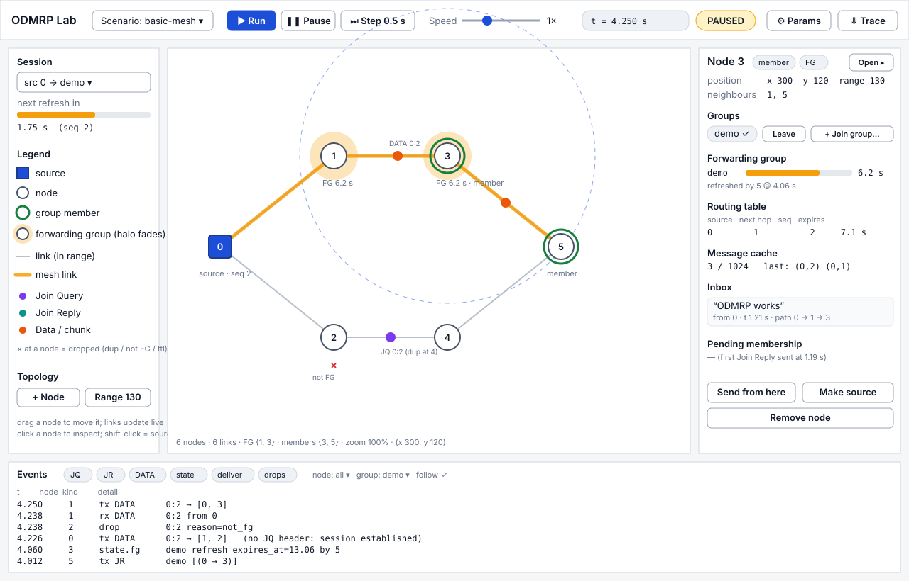
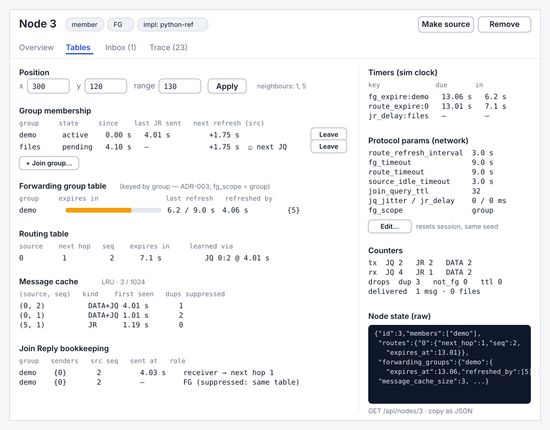
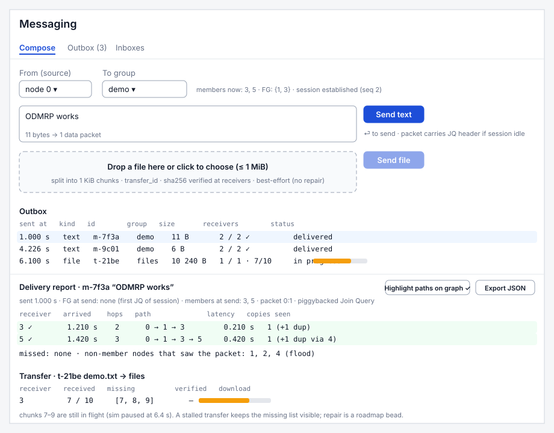
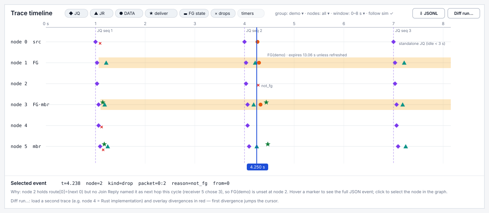

# Notional display mockups

Wireframes for the Svelte frontend (Phase 5 beads `odmrp-2q8` … `odmrp-5y1`). They are deliberately low-fidelity: layout, information architecture and data bindings are normative; colours and typography are placeholders. Every value shown comes from the basic-mesh fixture at `t = 4.25 s` (see `../sequences/01-mesh-formation.md`), so the screens can be compared with the trace when the UI is built.

| # | Screen | File | Primary bead |
|---|---|---|---|
| 1 | Network view (main screen) | `01-network-view.svg` | `odmrp-ey7`, `odmrp-g22`, `odmrp-huq` |
| 2 | Node inspector (Tables tab) | `02-node-inspector.svg` | `odmrp-ak4` |
| 3 | Messaging panel + delivery report | `03-messaging-panel.svg` | `odmrp-5y1` |
| 4 | Trace timeline | `04-trace-timeline.svg` | `odmrp-huq`, `odmrp-hbl` |

## 1. Network view



Regions and bindings:

| Region | Shows | Data source | Interaction |
|---|---|---|---|
| Toolbar | scenario picker, Run / Pause / Step, speed, sim clock, mode badge, Params, Trace download | `sim` frame, `GET /api/network` | `POST /api/sim/*`, `PUT /api/sim/speed`, `POST /api/network/scenario` |
| Session panel | selected (source, group) session; countdown to the source's next Join Query | `NodeState.sessions[].next_refresh_at` of the source | choose which session drives highlighting |
| Legend | visual encoding (below) | static | — |
| Canvas | nodes at simulated positions, links, mesh links, FG halos, member rings, source square, range circle of the selected node, packets in flight, drop marks, badges | `topology`, `nodes`, `tx/rx/drop` events | drag = move node (`PUT /api/nodes/{id}/position`), click = select, shift-click = make source, wheel = zoom |
| Inspector summary | the selected node's groups, FG countdown, routing table, cache size, inbox, membership pending state | `GET /api/nodes/{id}` + `node` frames | Join / Leave, Send from here, Make source, Remove, Open full inspector |
| Events | filterable tail of the trace | `events` frames (ring buffer) | filter chips, follow toggle, click row → select node / packet |

Visual encoding (also the legend):

| Element | Encoding | Rationale |
|---|---|---|
| Source | filled blue square | distinct shape so it reads even when it is also FG/member |
| Group member | green ring | receivers are "ringed in" |
| Forwarding-group node | amber halo whose opacity is proportional to remaining `expires_at − t` | soft state is visible as it decays; a refresh snaps it back to full |
| Mesh link | thick amber segment between two nodes that are both in {source} ∪ FG ∪ members **and** neighbours | shows the forwarding mesh as a subgraph without implying tree structure |
| Join Query / Join Reply / Data | purple / teal / orange dot travelling from `tx` node to `rx` node over the hop delay | one colour per packet kind, consistent across all four screens |
| Drop | red × at the receiving node for ~300 ms with the reason beneath | makes "duplicate" and "not FG" suppression visible instead of silent |
| Pending membership | dashed green ring | the node joined but has not yet answered a Join Query (F-05 in the review) |

## 2. Node inspector



A modal/drawer version of the right-hand summary with four tabs. The *Tables* tab is the one that matters for protocol work: it shows exactly the draft's three tables (routing, forwarding group, message cache) plus the prototype's two bookkeeping structures (group membership state, Join Reply suppression). The right column shows the node's armed timers, the network-wide protocol parameters, per-kind counters, and the raw `NodeState` JSON as served by `GET /api/nodes/{id}` so a developer can paste it into a test.

Every row that carries an expiry renders a countdown bar; bars are driven by sim time (they stop when paused).

## 3. Messaging panel



Compose (text or file) bound to a source node and a group, with an inline hint of who would receive it now (members, FG set, session state). The outbox lists each injected message/transfer with a live receiver count; selecting one opens the delivery report built from the trace (`odmrp-o8u`): per-receiver arrival time, hop count, path (clickable → highlighted on the canvas), latency and duplicate copies seen. Transfers add a per-receiver progress bar and the `missing` chunk list; partial transfers are shown honestly rather than hidden (F-15).

## 4. Trace timeline



A swim-lane view of the JSONL trace — one lane per node, one marker per event, amber bands for FG state, dashed verticals at every Join Query origination. The cursor is synchronised with the sim clock; clicking a marker shows the full event and explains *why* (the example explains a `not_fg` drop). The **Diff run…** action loads a second trace (e.g. a run with node 4 implemented in Rust) and overlays the first divergence — this is the UI face of roadmap bead `odmrp-izv`.

## Layout notes for implementation

- Breakpoints: ≥ 1280 px three-column (as drawn); 960–1279 px the inspector collapses into a drawer; < 960 px the event log becomes a tab.
- All panels are resizable splitters; the canvas keeps a fixed aspect so positions stay comparable with the scenario file's coordinate space.
- Colours above must pass WCAG AA on white; the amber halo is decorative and always paired with the `FG` text badge.
- Nothing in the UI computes protocol state; if a value cannot be read from `NodeState` or an event, it is a backend gap to fix (add it to the schema), not a frontend derivation.

## Regenerating previews

```bash
rsvg-convert -w 1280 docs/mockups/01-network-view.svg -o /tmp/01.png
```
