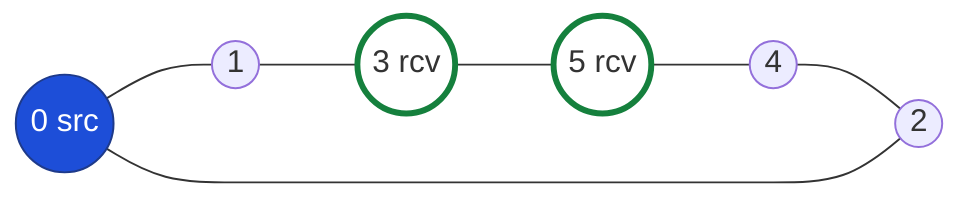

# Sequence 1 — Mesh formation (Join Query flood, Join Reply return)

Fixture: `scenarios/basic-mesh.yaml` (range 130, jitter 0). Source **0**, receivers **3** and **5**. Links form the ring `0–1–3–5–4–2–0`.



Draft references: §5.1.1 originate JQ, §5.1.2 process JQ, §5.1.5 originate JR, §5.1.6 process JR. Hop delay `d` is the medium's per-hop latency; with jitter 0 the scheduler's `(t, seq)` ordering makes node 1's rebroadcast precede node 2's because node 1's `rx` was scheduled first.

## 1.1 First refresh cycle (t = 1.0, message "ODMRP works" injected at node 0)

```mermaid
sequenceDiagram
  autonumber
  participant S as Node 0 (source)
  participant A as Node 1
  participant B as Node 2
  participant R1 as Node 3 (member)
  participant C as Node 4
  participant R2 as Node 5 (member)

  Note over S: originate(demo, "ODMRP works")<br/>session Idle → Querying, seq=1<br/>DATA + JoinQueryHeader(piggybacked), ttl=32, hop=0
  S->>A: DATA+JQ(src=0, seq=1, prev=0)
  S->>B: DATA+JQ(src=0, seq=1, prev=0)

  Note over A: cache (0,1); route[0]=(next=0, seq=1)<br/>not member → no JR; hop=1, ttl=31
  A->>S: DATA+JQ(prev=1)  — duplicate at 0, dropped
  A->>R1: DATA+JQ(prev=1)
  Note over B: cache (0,1); route[0]=(next=0)
  B->>S: DATA+JQ(prev=2)  — duplicate, dropped
  B->>C: DATA+JQ(prev=2)

  Note over R1: cache; route[0]=(next=1)<br/>member of demo → deliver payload (inbox)<br/>originate JR after jr_delay
  R1->>A: DATA+JQ(prev=3) — duplicate
  R1->>R2: DATA+JQ(prev=3)
  R1-->>A: JOIN_REPLY{group=demo, [(sender=0, next_hop=1)]}
  R1-->>R2: JOIN_REPLY (no entry with next_hop=5 → ignored)

  Note over A: entry next_hop==1 → FG_FLAG(demo), expires=now+9<br/>build own JR: next_hop = route[0].next_hop = 0
  A-->>S: JOIN_REPLY{[(0, next_hop=0)]}
  A-->>R1: JOIN_REPLY (ignored at 3: next_hop≠3)
  Note over S: entry sender==self → mesh established (observational)

  Note over C: cache; route[0]=(next=2); not member
  C->>B: DATA+JQ(prev=4) — duplicate
  C->>R2: DATA+JQ(prev=4) — duplicate at 5 (already cached via 3)

  Note over R2: first JQ arrived via 3 → route[0]=(next=3)<br/>member → deliver payload; originate JR
  R2->>R1: DATA+JQ(prev=5) — duplicate
  R2->>C: DATA+JQ(prev=5) — duplicate
  R2-->>R1: JOIN_REPLY{[(0, next_hop=3)]}
  R2-->>C: JOIN_REPLY (ignored at 4)

  Note over R1: entry next_hop==3 → FG_FLAG(demo), expires=now+9<br/>own JR would be [(0, next_hop=1)] — identical to the table already sent this cycle<br/>→ suppressed (draft §3.1: "broadcasts only once … no new source information")
  Note over A,S: FG set after cycle 1 = {1, 3}. Nodes 2, 4 hold routes but are not FG.
```

Resulting state (also the expected trace assertions for bead `odmrp-rlo`):

| Node | route[0].next_hop | FG(demo) | member | inbox |
|---|---|---|---|---|
| 0 | — (self) | — | no | — |
| 1 | 0 | **yes** (exp. 10.0+) | no | — |
| 2 | 0 | no | no | — |
| 3 | 1 | **yes** | yes | "ODMRP works" |
| 4 | 2 | no | no | — |
| 5 | 3 | no | yes | "ODMRP works" |

Why node 3 is FG although it is a receiver: node 5 chose 3 as its next hop toward the source, so 3 is on another receiver's reverse path. A receiver that is also a forwarder is normal in ODMRP and is one reason the mesh is not a tree.

### Jittered variant

With `jq_jitter > 0`, node 5 may hear node 4's rebroadcast before node 3's. Then `route[0] = (next=4)` at node 5, node 5's Join Reply targets 4, which becomes FG and forwards `[(0, next_hop=2)]`, making 2 FG as well. Final FG set `{1, 2, 4}`; node 3 is a plain receiver. Both outcomes are correct ODMRP; which one occurs is a function of the seed, which is why determinism tests fix the seed and the Phase 0 fixture disables jitter.

## 1.2 Where the suppression rule matters

The draft's worked example (§3.1): I2 receives Join Replies from both R1 and R2 but "broadcasts the Join Reply only once even though it receives two … because the second table arrival carries no new source information." In the prototype:

```mermaid
sequenceDiagram
  participant I as Intermediate node
  participant U as Upstream
  Note over I: forwarded[(group, frozenset(senders), source_seq)] = True
  I-->>U: JOIN_REPLY{[(S1, next_hop=U)]}
  Note over I: later JR arrives with senders ⊆ already forwarded, same source seq
  I->>I: refresh FG_FLAG only; no broadcast
  Note over I: JR arrives adding sender S2
  I-->>U: JOIN_REPLY{[(S2, next_hop=U')]}  — only the new entry
```

Implementation detail for `odmrp-vlo`: key the suppression set by the *source's* Join Query sequence number so each refresh cycle forwards again.

## 1.3 Refresh cycle (every ROUTE_REFRESH_INTERVAL)

```mermaid
sequenceDiagram
  participant S as Node 0
  participant Net as Network
  Note over S: t = 4.0: route_refresh fires<br/>data queued? → piggyback; else standalone JQ (empty payload)<br/>seq = 2
  S->>Net: JQ(seq=2) flood (same rules as 1.1)
  Net-->>S: Join Replies return along reverse paths
  Note over Net: every FG node refreshed: expires_at = now + FG_TIMEOUT<br/>nodes that stopped being on a reverse path are NOT refreshed and expire 9 s after their last refresh
```

Trace assertions for this cycle: one `tx` of kind `JOIN_QUERY` per node (no duplicates re-sent), `state.fg op=refresh` for every FG node, no `state.fg op=set` unless the topology changed.
