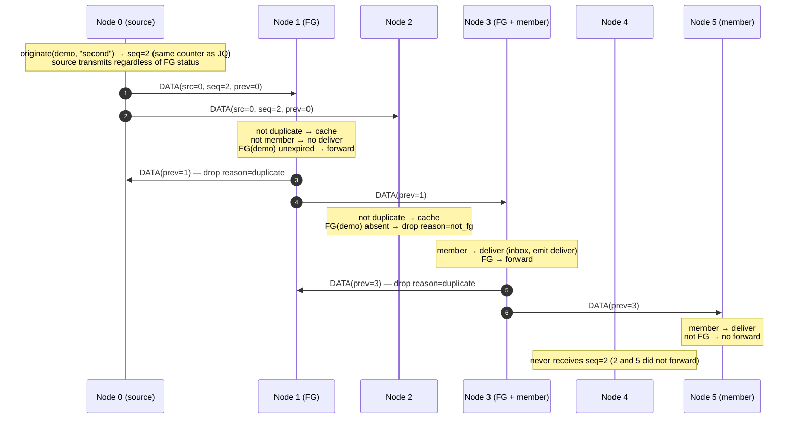
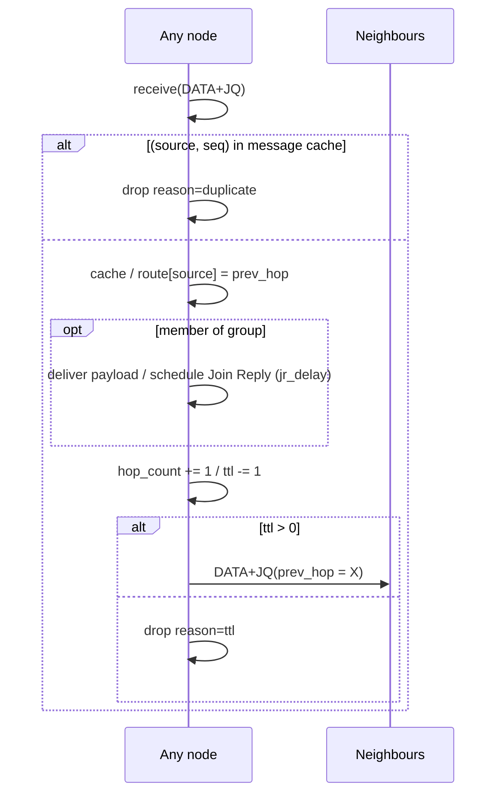
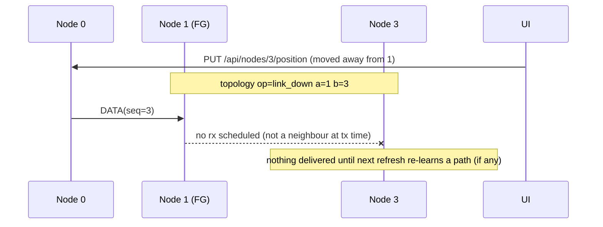

# Sequence 2 — Data forwarding through the forwarding group

Draft §5.2: "Nodes relay data packets only if the packet is not a duplicate and the setting of FG_FLAG for the multicast group has not expired." Fixture and FG set `{1, 3}` from `01-mesh-formation.md`.

## 2.1 Second message after the mesh exists (no Join Query header)

Decision table implemented by `odmrp-2xj`:

| duplicate? | member of group? | FG(group) unexpired? | action |
|---|---|---|---|
| yes | — | — | `drop reason=duplicate` |
| no | yes | yes | `deliver` + forward |
| no | yes | no | `deliver` only |
| no | no | yes | forward only |
| no | no | no | `drop reason=not_fg` (still cached, so a later copy is a duplicate) |

The source's own transmission is traced as `tx` with no preceding `rx`; the source never "forwards".

## 2.2 Data piggybacking a Join Query (first packet of a cycle)

When the packet carries a `JoinQueryHeader`, the Join Query rules run first (§5.1.2), then the payload is delivered to members. Forwarding of the *packet* follows the Join Query rule (rebroadcast if non-duplicate and TTL > 0) — i.e. a piggybacked data packet floods the whole network once per refresh. This is the ODMRP property that lets a brand-new receiver get the first packet of each cycle even before any FG exists.

## 2.3 Topology change between refreshes

If a link on the mesh breaks (node moved out of range) between refreshes, data is simply lost on that branch until the next Join Query/Join Reply cycle rebuilds the mesh — there is no local repair in base ODMRP (E-ODMRP and PatchODMRP add it). The sequence is therefore the same as 2.1 with the `rx` events missing on the broken link; the delivery report (`04-messaging-file-transfer.md`) shows which receivers were reached.

Trace assertion for the regression test: after `link_down`, the next `JOIN_QUERY` cycle produces a `state.route op=set` at node 3 with a new `next_hop` (or none if partitioned), and FG membership of node 1 is *not* refreshed by node 3 any more and expires at `last_refresh + FG_TIMEOUT`.
