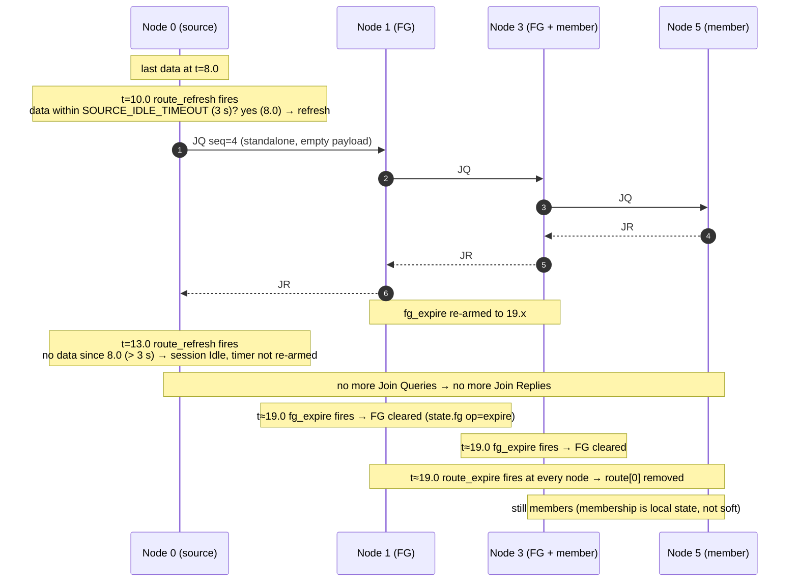
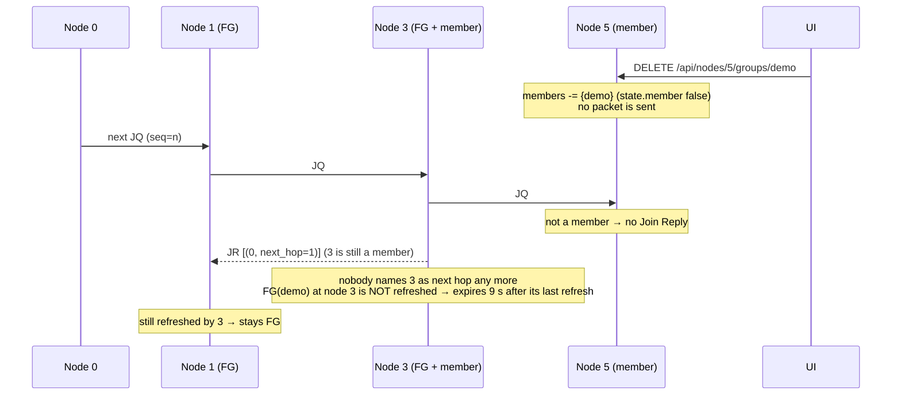
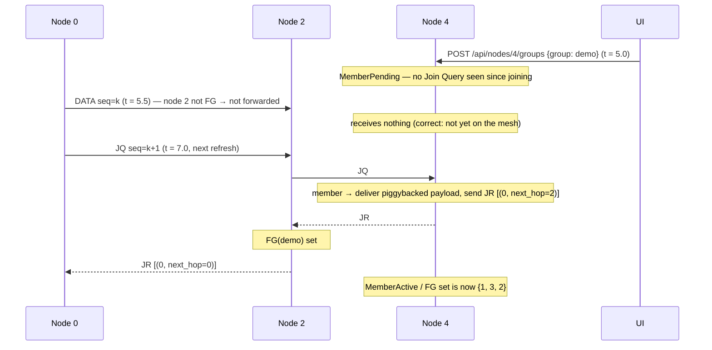
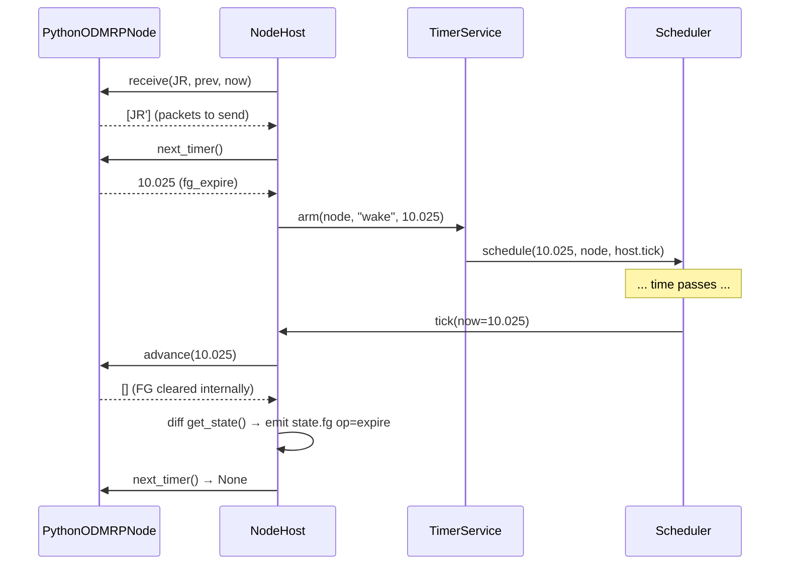

# Sequence 3 — Soft state: refresh, expiry, leave

Draft §3.3 (no explicit leave), §3.4 (FG timeout 3–5× refresh). Defaults: `ROUTE_REFRESH_INTERVAL = 3 s`, `FG_TIMEOUT = 9 s`, `ROUTE_TIMEOUT = 9 s`, `SOURCE_IDLE_TIMEOUT = 3 s`.

## 3.1 Timeline of one FG node while the source keeps sending

```mermaid
gantt
  title FG node 1 — timers (source active from t=1.0)
  dateFormat X
  axisFormat %s s
  section Source 0
  JQ seq=1            :milestone, m1, 1, 0
  JQ seq=2            :milestone, m2, 4, 0
  JQ seq=3            :milestone, m3, 7, 0
  JQ seq=4            :milestone, m4, 10, 0
  section Node 1 FG(demo)
  FG set  (exp 10.x)  :a1, 1, 9
  refresh (exp 13.x)  :a2, 4, 9
  refresh (exp 16.x)  :a3, 7, 9
  refresh (exp 19.x)  :a4, 10, 9
```

Each Join Reply that names node 1 as next hop re-arms `fg_expire:demo` to `now + 9`. The entry never expires while refreshes keep arriving every 3 s.

## 3.2 Source stops: everything drains without any leave packet

Worst-case residual: an FG flag can outlive the last data by `SOURCE_IDLE_TIMEOUT + FG_TIMEOUT` (here 8.0 → 19.x s). This is inherent to soft state and is what the UI's fading halo visualises.

## 3.3 Receiver leaves: upstream forwarders expire

After node 3's FG flag expires, the mesh is exactly the path `0–1–3` serving the one remaining receiver. Nothing was signalled; the mesh shrank by omission.

## 3.4 Receiver joins late: pending until the next refresh

Expected join latency is uniform in `[0, ROUTE_REFRESH_INTERVAL)`; the inspector shows the countdown to the source's next refresh so the delay is explainable.

## 3.5 Timer bookkeeping (host side)

The node keeps its own due-list; the host only needs one wake-up timer per node. External implementations follow the identical pattern over IPC.
