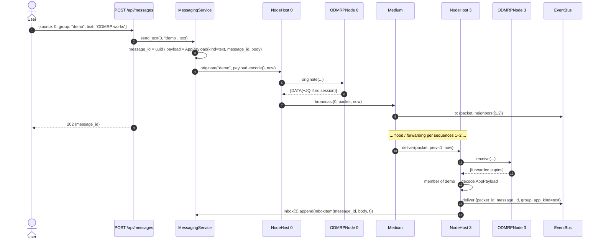
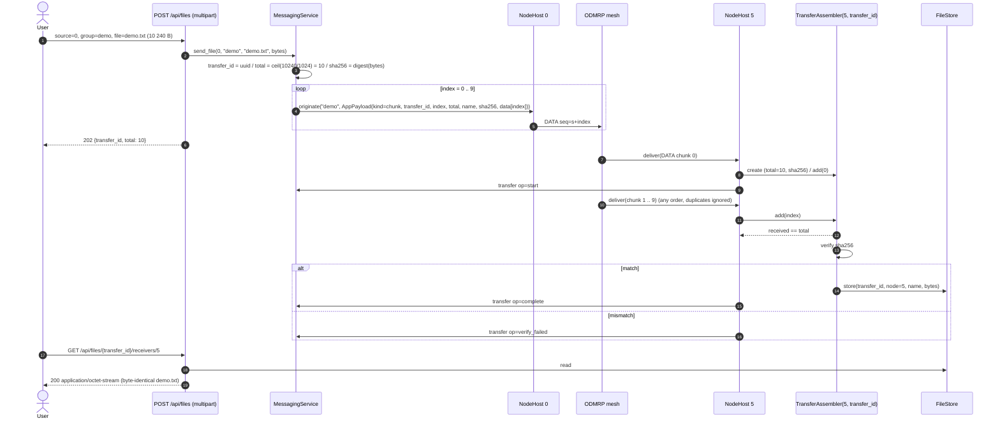
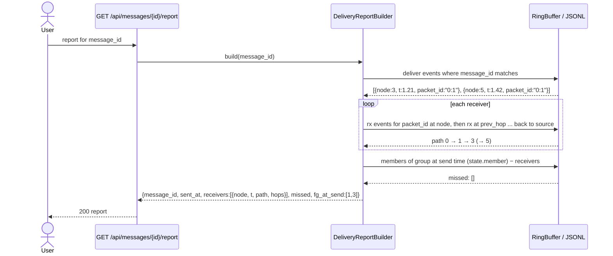

# Sequence 4 — Messaging and file transfer

Application layer (`specs/messaging/spec.md`) on top of ODMRP data packets. Beads `odmrp-2kc`, `odmrp-a1c`, `odmrp-o8u`.

## 4.1 Text message end to end

The HTTP response returns before delivery (the simulation may be paused). Delivery is observed through the WebSocket `deliver` events or `GET /api/messages/{id}/report`.

## 4.2 File transfer: chunking and reassembly

Because chunks ride ordinary data packets, each one is forwarded by the same FG rule; there is no separate reliability. If the mesh refreshes mid-transfer (every 3 s) the first chunk after the refresh simply carries the Join Query header.

## 4.3 Delivery report (built from the trace)

For a transfer, the report is per receiver `{received, total, missing:[...], complete, verified}` and the path is that of the first chunk.

## 4.4 What the UI shows (ties to `docs/mockups/03-messaging-panel.svg`)

| Event | Messaging panel | Network view |
|---|---|---|
| `tx` of first chunk / message at source | row appears with status *sent* | dot leaves node 0 |
| `deliver` at node | receiver chip turns green, shows `t` | node flashes |
| `transfer op=chunk` | progress bar `received/total` per receiver | — |
| `transfer op=complete` | download icon enabled | — |
| report row clicked | — | path edges highlighted |
