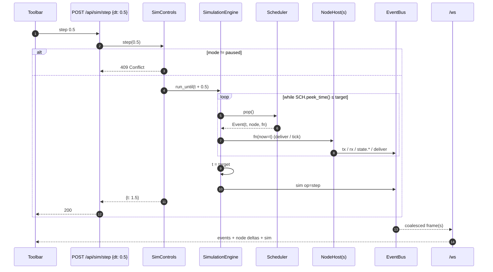

# Sequence 5 — UI ↔ API ↔ simulation (snapshot, deltas, controls)

Beads `odmrp-deb`, `odmrp-hlj`, `odmrp-f2f`, `odmrp-2q8`. Frame schema in `../architecture/03-data-model-and-interfaces.md` §3.6.

## 5.1 Page load and WebSocket subscription

```mermaid
sequenceDiagram
  autonumber
  participant B as Browser (Svelte)
  participant ST as sim store
  participant WS as /ws (broadcaster)
  participant SES as SimulationSession
  participant BUS as EventBus

  B->>WS: connect /ws?after_seq=0
  WS->>SES: snapshot()
  SES-->>WS: {sim, params, topology, nodes, last_seq}
  WS-->>B: {type:"snapshot", ...}
  B->>ST: replace everything
  WS->>BUS: subscribe(client)
  loop every ≤ 50 ms while events pending
    BUS-->>WS: events (tx, rx, state.*, deliver, ...)
    WS-->>B: {type:"events", events:[...]}
    B->>ST: append to ring; update node state from state.* deltas
    WS-->>B: {type:"node", id, state}   (only when a node's state changed)
    B->>ST: merge
  end
```

Reconnect: the client sends its last `seq`; if the ring buffer still holds it the server replays, otherwise it sends a fresh snapshot and a `gap` frame.

## 5.2 Stepping the simulation from the toolbar



Mutations issued while paused (join group, send message, move node) are executed immediately at the current `t` and traced; their effects propagate on the next step. This is what makes the Gherkin scenarios deterministic.

## 5.3 Run mode (real-time driver)

```mermaid
sequenceDiagram
  participant B as Toolbar
  participant API as POST /api/sim/run
  participant CTL as SimControls
  participant RT as RealTimeDriver (asyncio task)
  participant ENG as SimulationEngine
  B->>API: run
  API->>CTL: run()
  CTL->>RT: start(speed)
  loop every 20 ms wall-clock
    RT->>ENG: run_until(t + 0.020 × speed)
    Note over ENG: identical code path to step; wall-clock only decides how far to advance
  end
  B->>API: PUT /api/sim/speed {multiplier: 4}
  API->>RT: speed = 4
  B->>API: POST /api/sim/pause
  API->>RT: stop()
```

The real-time driver never reads the clock inside the engine; it only chooses the next `run_until` target. Replaying the same scenario in step mode therefore yields the same trace as run mode.

## 5.4 Dragging a node

```mermaid
sequenceDiagram
  participant NV as NetworkView
  participant ST as sim store
  participant API as PUT /api/nodes/4/position
  participant TOPO as Topology
  participant BUS as EventBus
  participant WS as /ws
  NV->>ST: optimistic position (during drag, local only)
  NV->>API: on drop {x, y}
  API->>TOPO: move(4, pos, now)
  TOPO->>TOPO: recompute neighbours of 4 only
  TOPO->>BUS: topology op=move; link_down(2,4); link_up(4,5) ...
  BUS-->>WS: events
  WS-->>ST: authoritative position + link deltas (overrides optimistic)
```

## 5.5 Loading a scenario

```mermaid
sequenceDiagram
  participant B as Toolbar
  participant API as POST /api/network/scenario {name: "basic-mesh"}
  participant SCN as ScenarioLoader
  participant SES as SimulationSession
  participant ENG as SimulationEngine
  B->>API: load basic-mesh
  API->>SCN: load("scenarios/basic-mesh.yaml")
  SCN->>SES: reset(seed, params)
  SES->>ENG: new engine; add nodes; schedule script ops at their `at` times
  ENG-->>SES: sim op=load {seed, scenario}
  SES-->>API: ok
  API-->>B: 200
  Note over B: WebSocket delivers a fresh snapshot; mode = paused at t = 0
```

Scripted operations (`join`, `text`, `file`, `move`, `leave`) are ordinary scheduler events, so a scenario run is reproducible headlessly with `python -m odmrp_sim.cli run scenarios/basic-mesh.yaml --until 20 --trace out.jsonl`.
