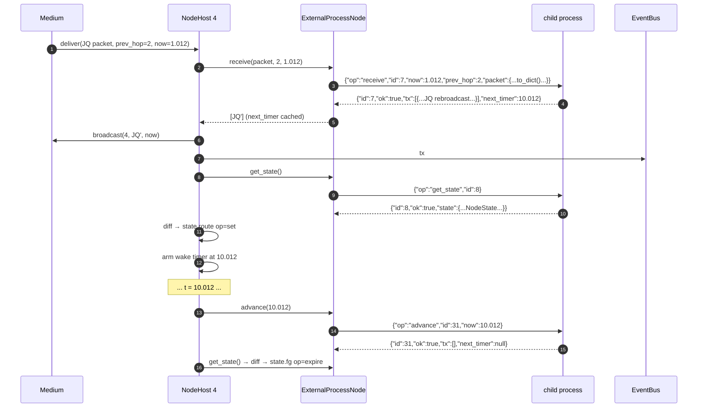
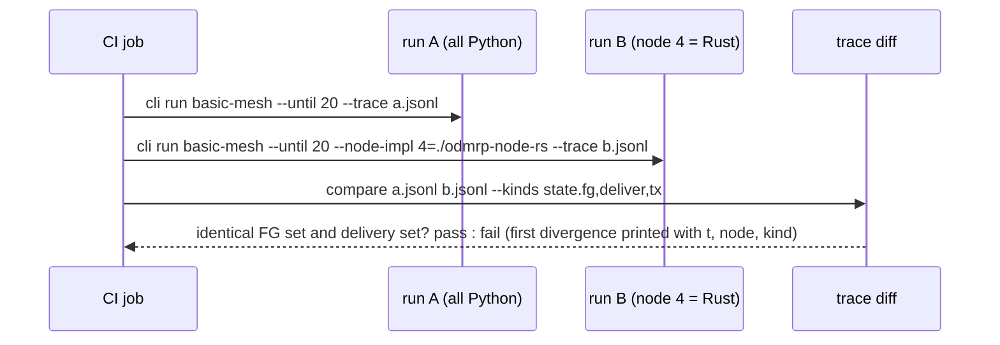

# Sequence 6 — External node adapter (C++ / Rust process as node N)

Roadmap bead `odmrp-dn0`, contract documented by `odmrp-hbl`. The adapter is an `ODMRPNode` implementation (`ExternalProcessNode`) whose seven methods are forwarded as NDJSON requests over the child process's stdin/stdout. Because the seam is time-driven and pure-output (ADR-005), the external node needs **no** scheduler, socket or clock of its own.

## 6.1 Lifecycle

```mermaid
sequenceDiagram
  autonumber
  participant SES as SimulationSession
  participant H as NodeHost 4
  participant X as ExternalProcessNode
  participant P as child process (odmrp-node-rs)
  SES->>H: create node 4 with impl = external("./odmrp-node-rs")
  H->>X: configure(node_id=4, params, rng_seed)
  X->>P: spawn; stdin/stdout pipes
  X->>P: {"op":"configure","id":1,"node_id":4,"params":{...},"rng_seed":1234}
  P-->>X: {"id":1,"ok":true}
  Note over X,P: one request in flight at a time; every request gets exactly one reply
  SES->>H: ... simulation runs ...
  SES->>H: shutdown
  H->>X: close()
  X->>P: {"op":"shutdown","id":99}
  P-->>X: {"id":99,"ok":true}  then exits
```

## 6.2 Packet delivery and timer round-trip



`get_state` after every call is the simplest conformant behaviour; an optimisation is for the reply to include `"state_changed": true/false` so the host only fetches state when needed.

## 6.3 Wire format (NDJSON, UTF-8, one object per line)

Requests (host → node):

| `op` | fields | reply fields |
|---|---|---|
| `configure` | `node_id`, `params`, `rng_seed` | — |
| `set_membership` | `group`, `member`, `now` | `tx` |
| `originate` | `group`, `payload_b64`, `now` | `tx` |
| `receive` | `packet`, `prev_hop`, `now` | `tx`, `next_timer` |
| `advance` | `now` | `tx`, `next_timer` |
| `get_state` | — | `state` |
| `shutdown` | — | — |

Every reply: `{"id": <request id>, "ok": true, ...}` or `{"id": .., "ok": false, "error": "<message>"}`. An `ok:false` reply is traced as `drop reason=malformed` for `receive` and as a fatal error for anything else. Packet objects use the exact `Packet.to_dict()` layout from `../architecture/03-data-model-and-interfaces.md` with `payload_b64` for bytes.

## 6.4 Mixed-implementation run and trace diff (roadmap `odmrp-izv`)



Because every node's RNG substream is derived from `(seed, node_id)` and the medium owns all delays, a conformant external node produces a byte-identical trace for the `state.*` and `deliver` kinds. `tx` payload ordering within one call is also part of the contract (list order = transmit order).

## 6.5 Conformance checklist for implementers (excerpt for `docs/external-node-contract.md`)

1. Message cache keyed `(source, seq)`; capacity from `params.message_cache_size`; LRU.
2. Routing entry inserted/refreshed on every non-duplicate Join Query; `next_hop = prev_hop`.
3. Member → Join Reply table with one entry per unexpired route, after `params.jr_delay`.
4. Join Reply with an entry `next_hop == node_id` → FG for `params.fg_timeout`; own table from matched entries; broadcast once per `(group, senders, source seq)`.
5. Data: forward iff non-duplicate and FG unexpired; deliver iff member; never forward as source.
6. `advance(now)` fires all timers `≤ now` in due order; `next_timer()` reports the earliest remaining.
7. No wall-clock, no own randomness beyond `rng_seed`-derived.
